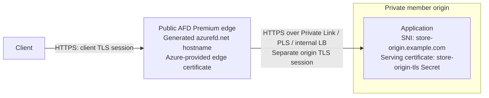

# Proposal: End-to-end TLS with HTTPS private origins for GEP-1748

**Status: experimental implementation on this branch; not released or live-certified.** Based on merged commit
`4f80e9e42de24d3a775d2f877fd27b51185fde7e`. This is an end-to-end TLS extension
of the [customer how-to](../howtos/gateway-api-afd-configuration.md), not an
production-readiness claim. The contract below remains the engineering acceptance
baseline; the complete live scenario matrix is not established by offline tests.

### Implementation and rollout

- Both existing managers expose `--enable-origin-tls` (default `false`); both
  charts expose `enableOriginTLS: false`. Member enablement requires private-origin
  discovery; hub enablement requires AFD provisioning. TLS-off startup has no
  experimental BackendTLSPolicy CRD dependency.
- Install the upgraded internal CRD on the hub **before** enabling members, then
  install the pinned Gateway API v1.2.1 experimental BackendTLSPolicy CRD in hub
  and members. Enabled managers check the served version and internal transport
  schema through uncached API reads before starting.
- Internal `spec.originTLS` contains the typed non-secret observation and policy
  identity. A one-minute (jittered) refresh writes a controller-owned internal
  metadata heartbeat bound to the SHA-256 digest of that exact snapshot.
  Unchanged snapshots retain their spec timestamp/generation, preserving existing
  MCS conflict acknowledgement. Intent expires after five minutes; timestamps over
  one minute in the future or mismatched heartbeat bindings are rejected.
- Hub agreement/projection and pre-write/post-write authorization use current API
  inventory. No policy/export alone creates ingress. The generated policy belongs
  to the ServiceImport UID and is shared across real authorized Gateway ancestors.
- Withdraw HTTPS routes/Gateways and observe provider cleanup before disabling
  or downgrading the hub. Disabling members clears the envelope on reconciliation;
  unreachable members expire rather than retaining authority indefinitely.
- The separately gated installed-controller fixture is
  `ENABLE_AFD_PRIVATE_HTTPS_PROOF=true`, label `afd-private-https-proof`. It reads
  approved certificate/key **file paths** from environment variables, never AKV
  credentials in controllers. See the [fixture runbook](../../test/https-origins-certificates.md).
  It has not been run against live Azure for this change.

**Audience:** Engineering and design reviewers. Customer prerequisites, manifests,
ownership checklist and diagnostic steps belong in the
[AFD how-to](../howtos/gateway-api-afd-configuration.md#proposed-https-origins),
not in this implementation plan.

## Goal and boundaries

Encrypt and authenticate both the client-to-AFD Premium and AFD-to-member
application connections over the existing Private Link/internal LoadBalancer
topology, without introducing a proxy, another controller Deployment, public
member origins, or customer access to the hub.



AFD terminates a client TLS session and establishes a new TLS session to the
origin; this is not TLS passthrough. An Azure Load Balancer/PLS transports the
connection, not the application certificate. The workload behind the selected
Service port terminates origin TLS.

Both TLS connections are required by the proposed secure workflow. Use AFD's
generated endpoint hostname and its Azure-provided/renewed edge certificate;
custom client domains, their DNS validation/renewal and frontend BYOC remain
deferred. No customer edge Secret, Key Vault or public DNS record is required
for this generated hostname. This does not issue or renew member certificates.
The listener explicitly selects HTTPS; do not enable HTTP or an HTTP redirect
implicitly. Preserve existing HTTP-preview behavior only for separate explicit
HTTP configurations, not as a fallback for this workflow.

Keep the existing root `PathPrefix: /`, one logical backend port, same-namespace
HTTPRoute backend, capacity, ownership and Private Link authorization limits.
Multi-backend/path-routing expansion, WAF, optional Traffic Manager resilience,
custom client domains, frontend BYOC, custom origin CAs, client mutual TLS and
origin mutual TLS are outside this scope.
AFD does not support mTLS from Front Door to origins.

## Current implementation versus proposed behavior

| Area | Merged implementation | Proposed end-to-end TLS subset |
|---|---|---|
| Client listener | One unrestricted HTTP/80 listener | One HTTPS/443 listener, generated AFD hostname, Azure-provided edge certificate |
| Accepted edge protocols | HTTP | HTTPS only; HTTP does not forward to the application |
| Backend protocol | TCP with absent or `http` appProtocol | Also accept explicit `https` with a valid TLS policy |
| Origin destination | Verified internal IPv4 and exact PLS binding | Retain that provenance; configure a separate DNS TLS identity |
| Forwarding | `HTTPOnly` | `HTTPSOnly` for a TLS backend; never `MatchRequest` |
| Application port | Selected ServiceImport port as HTTP port | Selected ServiceImport port as HTTPS port |
| Probes | HTTP `GET /`, 30 seconds | HTTPS `GET /`, 30 seconds on the same backend port |
| HTTP Host | Omit ARM `originHostHeader` to preserve incoming Host | Unchanged; SNI is a separate identity |
| Certificates | No origin TLS handshake | AFD-trusted chain and matching hostname required |
| Customer backend settings | No edits to generated ServiceImport | Member Service-targeted TLS policy; controller-generated hub policy; platform-authorized routing |

The HTTP implementation already sets `EnforceCertificateNameCheck=true`, but
with HTTP forwarding that field does not establish a TLS connection. Merely
adding `HTTPSPort` or choosing port 443 is insufficient.

## MCS API shape and compatibility invariants

Follow the [upstream MCS API model](https://multicluster.sigs.k8s.io/concepts/multicluster-services-api/):
the application exports a same-name, same-namespace Service through ServiceExport;
controllers derive ServiceImport and the associated endpoint state. Origin TLS
must not introduce a different service identity or a customer-authored import.

The approved BackendTLSPolicy direction preserves that boundary:

- Add no fields to public ServiceExport/ServiceImport spec, status or port types.
  Keep TLS hostname, trust configuration, certificate references and AFD state
  outside those objects. A member policy references its Service; the generated
  hub policy references an import. Neither extends a public MCS type.
- Use the existing Service `spec.ports[].appProtocol: https` and exported port
  metadata. appProtocol is an application-protocol hint, not a certificate
  configuration API; the proposed AFD class requires explicit TLS intent and
  a supported policy. This is not a new MCS-wide requirement.
- Preserve existing member/export aggregation, namespace sameness, conflict
  handling and source identity. The single-port, private IPv4/PLS and trusted-CA
  restrictions apply to AFD eligibility, not to the MCS resource schemas.
- Missing/invalid TLS policy or certificate failures affect AFD configuration
  and delivery only. The Gateway controller must not unexport the Service,
  rewrite ServiceImport membership, or withdraw baseline MCS EndpointSlices
  merely because AFD cannot use the backend.
- Preserve the existing annotation boundary from GEP-1748: Azure-specific
  Gateway/Service annotations do not require new public MCS fields. A separate
  Gateway API policy also preserves MCS shape. A proposed member-policy annotation
  opts its typed TLS intent into Fleet export; hostname/trust remain policy fields,
  not annotations. Do not accept customer AFD annotations on generated imports.

**Existing compatibility limit:** Fleet currently uses the
`networking.fleet.azure.com` group and stores imported ports/type/IPs under
ServiceImport `status`; the upstream MCS API uses `multicluster.x-k8s.io` and
places those fields under `spec`. Fleet also carries `targetPort` in its existing
port type. This proposal preserves Fleet's current schema; it does not claim
wire compatibility/full upstream conformance or migrate these existing fields.
Any upstream-API migration requires a separate compatibility design.

## Selected customer contract

Use explicit protocol intent in the existing member Service and a same-namespace
member BackendTLSPolicy targeting that Service, explicitly annotated
`networking.fleet.azure.com/export-to-fleet: "true"`. Require exactly one
applicable policy per member Service for Fleet TLS eligibility. Application
customers manage only member workloads, certificate Secrets, Services, ServiceExports and TLS
policies. Fleet transports validated non-secret policy intent and automatically
reconciles one controller-owned hub BackendTLSPolicy targeting the corresponding
ServiceImport. Customers and platform operators do not hand-author that projection.
Neither hub read nor write access is a customer prerequisite, including
identity changes, verification and certificate rotation.

The platform still authorizes exposure through Gateway/HTTPRoute and returns
the generated HTTPS endpoint through the existing delivery channel. A member
ServiceExport or BackendTLSPolicy alone must not create a Gateway, HTTPRoute or
public AFD endpoint, attach to another tenant's routing, or authorize PLS approval.
Automatic generation of ingress authorization is outside this proposal.
PLS approval remains a separately authorized network/platform-owner task.

### Client-facing HTTPS and certificate ownership

The initial secure subset has exactly one listener: `protocol: HTTPS`,
`port: 443`, `tls.mode: Terminate`, no listener/HTTPRoute hostname restrictions,
and this proposed implementation-specific option:

```yaml
tls:
  mode: Terminate
  options:
    networking.fleet.azure.com/afd-default-certificate: "true"
```

This domain-prefixed Gateway API `tls.options` entry explicitly selects the
Azure-provided certificate for the generated AFD endpoint domain. It is not a
new MCS field, member annotation or currently implemented setting. The pinned
v1.2.1 Gateway TLS schema allows nonempty `options` instead of `certificateRefs`
for termination; this is implementation-specific support, not portable Secret
certificate support. Omit `certificateRefs`; no hub Secret or member key is
read for the edge. Reject missing/unknown options, values other than `"true"`,
certificate references, passthrough, explicit hostnames and additional listeners
instead of approximating their meaning. Validate this shape with the installed
pinned CRD in future admission/envtest tests.

Compile the edge route with `supportedProtocols: [Https]`,
`linkToDefaultDomain: Enabled` and `httpsRedirect: Disabled`; set
`forwardingProtocol: HttpsOnly` independently for the origin connection.
No custom-domain/certificate ARM resource is required for the default domain.
The HTTPRoute attaches explicitly to the HTTPS listener. An HTTPS listener
with an HTTP backend, or an HTTP listener with an HTTPS backend, is outside
this secure subset and must not program as end-to-end TLS.

Publish the observed generated hostname in existing Gateway `status.addresses`;
the operator hands `https://<observed-hostname>/` to the customer through the
existing delivery channel. Do not add a URL field to ServiceExport/ServiceImport
or copy Gateway status to member MCS objects. The generated hostname is tied to
the retained AFD endpoint: normal reconciliation and member join/leave must not
rotate that endpoint or customer URL. Endpoint/Gateway replacement is a separate
lifecycle boundary; do not promise hostname continuity across replacement.
Azure owns edge certificate provisioning/renewal; clients must still verify
the actual hostname and chain using normal trust.
Record edge certificate failures separately from origin certificate failures.
Default-domain TLS policy controls are Azure-owned; stricter client TLS/cipher
requirements must be assessed as a product gap, not silently mapped to a custom
domain. Custom-domain support remains a separate reviewed lifecycle.

### Client hostname continuity and custom-domain follow-up

A generated hostname establishes end-to-end TLS, but does not provide a
customer-owned application identity independent of the endpoint lifecycle.
Platform operators must disclose that limitation before handing off the URL
and plan client URL updates if replacement changes it.

Stable custom-domain support is a production requirement for workloads that
need the same application URL across endpoint/Gateway replacement. It remains
a follow-up, not implemented behavior or an expansion of this proposal's
generated-domain subset. A DNS CNAME alone is insufficient for HTTPS: the
follow-up must cover DNS ownership/delegation, AFD domain validation and routing,
edge certificate provisioning/renewal, and replacement cutover/recovery,
including propagation and traffic verification. Assess the resulting HTTP Host
and application compatibility separately from the origin SNI identity.

That workflow must preserve member-only customer Kubernetes access: platform
operators manage hub/AFD configuration in coordination with authorized DNS and
certificate owners. Do not require customer hub access or add public MCS fields.
Until that lifecycle is supported and validated, this subset does not satisfy
a customer's replacement-independent URL requirement.

### Member-side intent and certificate ownership

- Every exporting Service has the same namespace/name and one exported TCP port,
  with matching name, port and `appProtocol: https` across participating members.
  The port may be 443 or another valid TLS-serving port; do not infer TLS from
  its number or name. AFD connects to Service `port`, not `targetPort`.
  Fleet currently compares entire exported port lists, including `targetPort`;
  use matching exported values across members. Relaxing that existing behavior
  is not part of this proposal.
- Each workload serves a currently valid certificate and complete leaf/
  intermediate chain rooted in a CA trusted by AFD. Private enterprise CAs,
  self-signed certificates and a Kubernetes-only custom CA bundle cannot satisfy
  this contract.
- The policy's single precise DNS hostname must match every member certificate.
  For example, each member may have its own certificate/key for
  `store-origin.example.com`; sharing private keys across clusters is not
  required. A matching wildcard certificate is acceptable under AFD validation,
  but the configured hostname itself must not be a wildcard.
- Provision, store, mount/reload, monitor and rotate certificates through the
  application's existing certificate tooling. Fleet neither issues them nor
  copies private keys to the hub or Azure Front Door. DNS/certificate owners
  perform any CA domain-control validation.
- This requires control of a suitable DNS name, not a public application
  endpoint. Do not publish a public member LoadBalancer or add a public fallback
  to obtain a certificate. Verify the selected issuance/DNS arrangement in the
  live gate; do not assume public DNS or a Kubernetes Service DNS name proves
  AFD reachability or certificate trust.

### Member policy and generated hub projection

Use `gateway.networking.k8s.io/v1alpha3 BackendTLSPolicy`, as defined in the
repository's pinned Gateway API v1.2.1. The customer policy targets core
`Service` (`group: ""`) in the same member namespace. The generated hub policy
uses the **Fleet implementation-specific ServiceImport target** in the import
namespace. Service targeting uses the upstream resource shape; fleet-wide
aggregation and ServiceImport projection are Fleet behavior, not portable
Gateway API conformance. The resource is in that release's experimental CRD
channel; the platform must install it in participating members and the hub.
Today's standard CRD prerequisites are insufficient.

Recommended initial policy subset:

| Field | Supported proposal |
|---|---|
| `metadata.annotations["networking.fleet.azure.com/export-to-fleet"]` | Member policy: exact string `"true"` explicitly opts into Fleet export; not required/copied on the controller-owned hub projection |
| `targetRefs` | Customer: exactly one local core Service; generated hub policy: corresponding Fleet ServiceImport |
| `sectionName` | Absent; target has exactly one exported port |
| `validation.hostname` | Required precise DNS name shared by eligible members |
| `validation.wellKnownCACertificates` | Required `System`, meaning AFD's trust store, not the hub host's |
| `caCertificateRefs` | Unsupported; reject rather than ignore |
| `subjectAltNames` | Absent; separate SAN overrides cannot be honored by this AFD mapping |
| `options` | Empty/absent; no certificate-check bypass or arbitrary TLS options |

The target Service must have the same namespace/name as its ServiceExport and
one exported port. A member policy does not itself export a Service or authorize
an HTTPRoute. Do not infer the origin hostname from a Secret, port number,
cluster DNS name or member-provided ARM annotation.

#### Explicit Fleet export and coexistence

BackendTLSPolicy has no `spec.controllerName`. A local Service target alone does
not distinguish Fleet intent from a policy used by another implementation, such
as Istio. Require the proposed `networking.fleet.azure.com/export-to-fleet: "true"`
annotation on the customer-owned member policy before exporting its TLS intent.
Missing or other values do not authorize export. A matching ServiceExport is
also required; neither marker nor export replaces platform ingress authorization.
The hub policy is still generated automatically, not annotated/applied by the
customer, and its ownership is verified independently of this opt-in.

The annotation is a Fleet-specific export extension, not a standard controller
selector or an exclusive-ownership claim. Other implementations may consume the
same policy. Fleet must not alter their policy spec, metadata or status entries.
An unmarked policy alone is not Fleet TLS intent and is not projected, assigned
Fleet status or subjected to Fleet-specific field validation. Its existence must
not change baseline MCS exports or explicit HTTP-preview behavior.

The serving certificate/key are configured at the member application, for
example through a mounted TLS Secret. BackendTLSPolicy specifies what AFD must
validate, not where to fetch the server's private key. `caCertificateRefs`, when
supported by another implementation, specifies CA trust anchors rather than the
origin's serving certificate/key; it is unsupported by this AFD mapping.
Frontend Gateway certificate configuration is a separate TLS boundary covered
above; it never reuses or replaces the member serving Secret.

Require exactly one applicable BackendTLSPolicy per member Service before
exporting Fleet TLS intent. Count policy objects in the Service namespace whose
`targetRefs` include that core Service, including unmarked policies used by other
implementations. Zero policies or a sole unmarked/invalid/unsupported policy
cannot authorize Fleet TLS. More than one makes the Service ineligible for Fleet
TLS, even if the policies have identical settings or only one is opted in.
Do not choose by age/name, merge settings or skip an unmarked competing policy.

This is a deliberately stricter Fleet eligibility subset, not Gateway API's
oldest-policy conflict resolution or a claim of upstream precedence conformance.
It is not cluster-wide admission enforcement: other implementations may retain
their policies, and Fleet must not delete/edit them. Diagnose duplicate targets
on the opted-in policy, exclude that member from AFD TLS eligibility and let the
owners resolve the ambiguity. Apply the failure-scope rules below rather than
unconditionally withdrawing healthy members. One shared policy may still be
consumed by multiple implementations if their requirements agree.

Member policies may precede their Service/export; reconcile target appearance.
Watch all same-Service policy creations, deletions and target changes, including
unmarked policies. Limiting watches/indexes to opted-in objects would hide
duplicates and could leave stale TLS authorization in effect.

#### Internal transport and agreement

Extend the controller-owned InternalServiceExport transport, not public MCS
types, with an optional typed origin-TLS envelope. It must carry explicit
resolution state, the validated hostname/`System` contract and source
Service UID plus selected policy namespace/name/UID/generation, the exact
export annotation value and policy resourceVersion as an opaque
observation identifier, not a cross-cluster ordering or authorization token.
Do not copy arbitrary policy annotations. Retain the authenticated
member/reserved-namespace association and current export identity;
never accept another member's source claim or raw policy YAML as authorization.
No Secret, key, certificate chain or custom CA is transported. The branch uses
internal `spec.originTLS` and the digest-bound metadata heartbeat described above,
not a public ServiceExport/ServiceImport API extension.

Inventory the complete authoritative source set of a referenced logical HTTPS
backend, then resolve each member's local TLS eligibility independently. Missing,
unmarked, duplicate, invalid, unreadable or stale member policy intent makes that
member ineligible; record its identity/reason and safely isolate its owned AFD
origin rather than silently dropping it from the inventory. Absence from an
older member means unknown, not permission to assume a hostname.

Require at least one eligible member and current agreement on hostname/trust/
selected port across **all** otherwise eligible member intents. Two different
locally valid TLS identities are backend-wide ambiguity: withdraw the affected
route, not a majority vote or an exclusion chosen to manufacture agreement.
Never reuse stale successful intent or downgrade to HTTP. An ordinary
unexport/departure removes that source through existing ownership/membership
reconciliation. TLS exclusions affect AFD only; policy failures must not
unexport the Service or alter baseline MCS state.
Do not return early from ordinary export reconciliation in a way that suppresses
baseline MCS updates merely because TLS resolution failed.

Policy create/update/delete, same-Service policy count/target changes, export
opt-in changes, source Service replacement and read failures must refresh or
invalidate the envelope through the existing member export path and enqueue hub
aggregation. Do not preserve the last known valid contract on a known policy
deletion/read failure or opt-out.
Annotation-only updates do not increment policy generation; watch and transport
that change rather than relying on generation-only predicates or cache keys.
Removing/changing the opt-in must invalidate the previous TLS authorization,
not select another policy as an implicit fallback.
Transport interruptions/partitions must be distinguishable from a current
successful observation: the implemented five-minute expiry makes the affected
member ineligible without a fresh bound observation. Apply the
isolation/withdrawal rules below; do not claim instantaneous remote
revocation across a disconnected member.

#### Failure scope and safe origin isolation

- **Member-local failure:** missing/invalid/duplicate policy, opt-out or expired/
  unreadable member intent excludes only that attributable member. Continue
  serving eligible members with one unambiguous TLS contract after verifying
  that every excluded member has no owned origin, or its exact verified origin
  is administratively disabled/removed. Update generated-policy provenance and
  the desired graph to distinguish eligible sources from explicit exclusions.
- **Backend-wide failure:** withdraw the affected owned route for no eligible
  members, conflicting otherwise-valid TLS contracts, shared projection/
  ownership or protocol/port errors, or incomplete authoritative source
  inventory. Do not hide a valid conflicting intent as a local exclusion.
- **Unsafe isolation:** if source/binding attribution, owned Azure inventory,
  permissions or reconciliation errors prevent verified isolation, withdraw/
  suspend the affected route with bounded retry-safe operations. Never delete
  unverified inventory or continue claiming a safe degraded graph.
  If provider errors also prevent route suspension, report the enforcement
  failure, retry/escalate and never claim that traffic has stopped.

Do not implement exclusion using health-probe failure alone: AFD can still send
to unhealthy origins. Verify explicit administrative exclusion and include
fresh negative traffic evidence in live tests. Provider propagation and
in-flight requests preclude instantaneous isolation or a zero-error guarantee;
bounded route suspension may be necessary until isolation is verified.
Report excluded members, reasons and degraded capacity through existing
status/events/logs and the platform handoff, without new public MCS fields or a
fabricated portable `Degraded` condition. Re-admit a repaired member only after
fresh single-policy validation, agreement and verified private/TLS programming.

#### Hub ownership, status and cleanup

The existing hub ingress reconciliation creates/updates a deterministic policy
named from the target (for example `store-api-origin-tls`), not from an arbitrary
member policy name, for an agreed explicitly referenced backend. Reuse it for
authorized Gateways under this controller. Record verified ServiceImport UID
and source-set provenance; bind ownership to the generated target lifecycle, not whichever
Gateway reconciles first. Do not edit/adopt an unowned same-name policy or
silently override a competing manually authored hub policy. Such collisions
block programming and surface an actionable operator error.

Invalidate the usable aggregate before projection updates/deletion, and never
treat a previously accepted generated policy alone as current authorization.
Verify both its contents and current source provenance at graph resolution.
Repair deletion/drift only from current agreeing eligible-member intent and
verified ownership. Isolated member failures update the projection's eligible
source/exclusion provenance without removing a valid shared contract. Backend-wide
ambiguity or unsafe isolation withdraws the affected owned route; invalidate/
remove an unusable projection with bounded retry-safe cleanup. Removing the
last authorized route reference or target/export set removes the generated
policy; deleting one of multiple Gateway references must not break the others.
Never delete customer-owned member policies or certificates during hub cleanup.

Hub policy acceptance uses real hub Gateway `status.ancestors` entries. The
customer-facing member diagnostic baseline is sanitized events on the opted-in
member policy, including missing target, invalid policy, duplicate targets and
transport failure. Do not invent top-level policy conditions, cross-cluster Gateway
ancestors, or new public MCS TLS status fields. No local Gateway ancestor is
fabricated to make the member policy look accepted; preserve other controllers'
valid status entries. A richer durable member-local projection/readiness API
requires explicit design before being promised. Operator hub diagnostics and
independent client/member evidence remain necessary for end-to-end readiness.

### Protocol and downgrade rules

| Listener | Exported appProtocol | Effective policy | Result |
|---|---|---|---|
| Existing HTTP/80 | Absent or `http` | None | Preserve explicit existing HTTP-preview behavior |
| Supported HTTPS/443 | `https` | Exactly one applicable, valid supported policy explicitly opted into Fleet export | HTTPS on both hops and HTTPS probes |
| HTTPS/443 | `https` | A member has zero/multiple applicable policies, or its sole policy is unmarked, invalid or stale | Isolate that member; serve agreeing eligible members only after verified exclusion |
| HTTPS/443 | `https` | No eligible members, conflicting valid intents, shared dependency failure or unsafe isolation | Withdraw the affected route; no HTTP fallback |
| HTTPS/443 | Absent or `http` | Any | Reject cleartext origin for the secure subset |
| HTTP/80 | `https` | Any | Reject cleartext edge for the secure subset |
| Any | Absent or `http` | Any Fleet-exported TLS policy | Configuration mismatch; do not silently serve HTTP |
| Any | Other, mixed or conflicting exports | Any | Reject incompatible protocol/export intent |

An effective TLS policy requires the single-policy gate in every eligible
member, complete source inventory with explicit verified exclusions, fresh
agreement across all eligible intents and a matching owned hub projection.
An old policy object or status alone is insufficient.

Deleting a member policy or removing its export opt-in invalidates that member's
authorization and requires origin isolation, not restoration of the HTTP preview.
Continue healthy-member service only under the failure-scope rules above.
Likewise, an unknown or
unsupported policy field or policy read error is not policy absence. A controller
without policy CRDs/RBAC must refuse the TLS capability explicitly, not ignore
HTTPS intent. Existing HTTP-only installations must not acquire an unconditional
experimental-CRD startup dependency.

## Network identity, SNI and Host

Keep three concepts separate:

1. **Network provenance:** member discovery verifies the internal LB IP, PLS
   resource ID/location, Service UID and exporting member. Retain all existing
   source identity, conflict, namespace and lifecycle checks.
2. **TLS identity:** set ARM origin `hostName` to the policy DNS hostname. The
   AFD Private Link ILB guidance specifies that this name supplies SNI and
   certificate-name validation. Set `enforceCertificateNameCheck=true`; the exact
   shared Private Link target still selects private connectivity.
3. **HTTP authority:** omit `originHostHeader`, preserving incoming Host for
   application requests. Do not replace it with the TLS hostname, send an empty
   string, or assume setting SNI rewrites Host.

For example, origin SNI is `store-origin.example.com` while the application sees
the generated AFD endpoint hostname as Host. Client TLS uses that generated
hostname for its separate SNI/certificate check, not the origin identity.
Applications must support this distinction and the actual AFD probe Host.
The origin hostname, certificate identity, HTTP authority and public DNS name
are not interchangeable.

Do not replace `PrivateLinkOrigin.internalIP` with a DNS string. Add separate
transport/TLS fields to the normalized backend/provider model; derive the shared
TLS hostname from the validated member agreement and matching generated hub
policy, not from unverified annotations. InternalServiceExport already carries
appProtocol; it now also needs the non-secret policy envelope described above.
Do not export certificates/Secrets or introduce per-member TLS identities or
new public ServiceImport fields.

For TLS backends, request `httpsPort` from the selected ServiceImport port,
`HTTPSOnly` forwarding, HTTPS probes, and name checks. Do not configure HTTP
forwarding/probes as an alternative. An ARM-default HTTP port, if returned by
Azure, does not authorize its use: observe effective forwarding and probe
protocols as well as ports. Verify exact SDK request/response semantics during
implementation.

Generalize the existing profile-wide PLS/port-sharing guard to effective origin
transport ports; retaining an HTTP-only check would miss TLS conflicts.
Unsupported sharing or mixed-protocol graphs fail before generating a write
plan. Keep the existing capacity limits; TLS does not authorize more origins.

## Controller lifecycle and observable UX

Extend existing member export and hub Gateway/HTTPRoute reconciliation, resolver
and AFD provider; no additional controller Deployment is required. Member
policy/Service watches drive envelope invalidation and refresh. Hub internal
export/target/generated-policy watches drive agreement, projection and all
affected Gateways, including same-Service policy count/target changes. Preserve
existing source/membership watches. Members receive policy read/watch and event
permissions; hub projection reconciliation receives scoped policy lifecycle and
status permissions. Member identities still write only their reserved hub
export namespace, never the shared backend policy or Gateway namespace.

The platform must explicitly enable the capability in member and hub managers,
install the updated internal transport CRD in the hub first, and install the
pinned experimental policy CRD in hub and participating members before use.
Define the concrete flag/chart surface
in the implementation plan; no new supported flag is introduced by this
document. Do not install CRDs opportunistically from the running controller.
No new Azure Key Vault access, origin Secret access or PLS approval permission
is needed by Fleet for application-owned certificates.

Before creating or activating resources, validate the entire supported graph,
edge certificate option, effective backend TLS policy, private bindings and
current owner. Observe the HTTPS-only accepted edge protocol, default-domain
association, disabled redirect, exact origin hostname/HTTPS port, forwarding/
probe protocol and name-check policy before reporting resources programmed.
An omitted PATCH property is not
proof that a stale Host override or TLS setting was cleared. Repair through a
verified supported operation, or remain unprogrammed with an actionable error.

| Signal | Proposed meaning |
|---|---|
| Member policy events | Local selection/validation/transport diagnostics, not hub or live TLS readiness |
| Generated hub policy ancestor `Accepted=True` | Supported aggregate selected for the real hub Gateway, not a successful TLS handshake |
| Existing status/events/logs report excluded members | Verified degraded configuration and explicit member/reason/capacity diagnostics; eligible members may still serve, without a new portable condition or MCS status field |
| Hub policy `Accepted=False` or projection error | Invalid/missing/conflicting aggregate or ownership collision, with a sanitized explanation |
| HTTPRoute parent `ResolvedRefs=False` | Missing/incompatible TLS dependency; use the pinned API reason appropriate to the failure |
| Gateway/listener `Programmed=False` | Desired owned TLS configuration is incomplete, invalid, drifting or withdrawing |
| Gateway/listener `Programmed=True` | Observed owned enabled graph matches desired TLS configuration; not proof of certificate validity or traffic |
| AFD telemetry and independent requests | Actual probe, handshake, member delivery and application-health evidence |

Retain observed generations and existing parent/controller status ownership.
Define and test exact route/Gateway failure reasons during implementation; do
not invent a new portable condition or claim the hub can inspect a certificate
it never reads. Surface denied policy reads, provisioning errors and unresolved
dependencies through status/events and sanitized logs.

Manual PLS approval and its authorization remain unchanged. Preserve current
configuration-based programming and endpoint-first activation; do not reinstate
null/Pending AFD approval or `NotStarted` deployment as blanket readiness gates.
Approval is still required for connectivity, independently of Programmed.

### Health and failures

Use platform-owned HTTPS `GET /` every 30 seconds on the selected backend port;
applications must return 200 without a redirect or probe authentication
requirement. Distributed probes can produce a higher aggregate rate.
Observe actual SNI, Host and TLS behavior in the live test rather than assuming
probe behavior equals forwarded application traffic.

Expired/untrusted certificates, an incomplete chain or a hostname mismatch must
fail TLS, never trigger cleartext forwarding or disabled validation. AFD, not
Fleet's configuration reconciler, observes these runtime failures. Do not
promise certificate-expiry alerts from Fleet or a Programmed transition for
unobserved handshake failures; platform monitoring must cover AFD failures
and application certificate expiry.

AFD's documented all-origins-unhealthy behavior can still send requests to
unhealthy origins. Probe failure alone does not guarantee traffic withdrawal.
TLS validation remains mandatory even in that case, and errors can reach
clients. Healthy-origin failover is not a zero-error or availability guarantee.

### Updates, withdrawal and rotation

- Continue adding/re-exporting eligible private members and pruning retired
  owned origins with exact Service UID/PLS identity. A transient discovery delay
  does not remove other valid private members. Port/protocol conflicts remain
  export errors, not an excuse to mix transports.
- Update a certificate for the same hostname at the workload with overlapping
  validity and verified reload. No Fleet policy update or hub private-key access
  is needed. Prove new TLS handshakes; existing connections can mask a bad reload.
- For a TLS hostname change, first deploy certificates valid for both old and
  new names to every participating member, then update each member policy.
  During disagreement withdraw the affected route; coordinated rotation may
  have an outage. Once all otherwise eligible intents agree, regenerate/observe
  the hub policy and AFD graph, prove traffic, then retire the old identity.
  Record excluded members; re-admission still requires the current contract.
- Quiesce the affected route before HTTP-to-HTTPS migration or other incompatible
  listener/port/transport updates; observe withdrawal before replacing the old
  graph. Stage and verify the complete edge-and-origin TLS graph before
  activation. Do not leave an enabled HTTP route pointing at a newly TLS-only
  application. Coordinate the member rollout or use a separate TLS-serving
  deployment during migration; zero-downtime migration is not promised.
  Deliver the HTTPS URL through the platform handoff and require clients to
  switch explicitly; no automatic HTTP redirect or fallback is introduced.
- On known invalid/missing required policy, withdraw the affected owned route
  only if no eligible members remain, shared TLS intent is ambiguous, or safe
  member-origin isolation cannot be verified. Otherwise explicitly disable/
  remove that member's verified owned origin, refresh projection provenance and
  continue the agreeing eligible members with degraded diagnostics. Read
  failures cannot authorize new writes or downgrade; apply bounded suspension
  rather than deleting unverified inventory or retaining stale member authority.
- Returning deliberately to HTTP requires an authorized coordinated member
  protocol/port change and policy removal. It is never error recovery.
- Preserve bounded operations, shared request pacing, inventory/ownership
  verification, retry safety, finalizers and retained-root re-export behavior.
  Gateway deletion removes owned AFD resources and its generated-policy
  reference; projection cleanup respects other authorized users of the backend.
  It does not delete member policies/certificates, application DNS or WAF assets.

## Customer workflow

The [proposed how-to addition](../howtos/gateway-api-afd-configuration.md#proposed-https-origins)
keeps the existing actor split and ServiceExport/ServiceImport contract:

1. The certificate owner supplies trusted origin certificates and a shared
   origin DNS identity; application teams configure TLS in every member.
2. Application teams create same-namespace Service-targeted BackendTLSPolicies
   with matching hostname/`System` trust in every member, then export matching
   private TLS Services with `appProtocol: https`. Fleet aggregates current
   intent and creates the hub ServiceImport-targeted policy automatically.
3. The platform operator installs/enables the future member/hub capability and
   explicitly authorizes ingress through HTTPS/443 Gateway/default-certificate
   option and HTTPRoute. No manual hub-policy apply step remains.
4. Network owners approve the exact AFD-to-PLS connections as today.
5. Operators verify policy/configuration status and independently prove both
   TLS connections, private delivery and HTTPS probes, then hand the generated
   HTTPS URL to the customer. Customers run plain `curl` with normal trust and
   inspect their member application logs; they never need hub credentials.

Customers change origin identity through their member policies, never the
generated hub policy. Platform ingress authorization, PLS approval, URL handoff
and Azure diagnostics remain operator procedures, not extra customer Kubernetes
permissions. Member-only policy driving does not imply automatic ingress creation.

No certificate material, trust-bypass annotation, configurable health-probe
annotation or PLS auto-approval is added to the customer workflow.

The customer-facing [readiness checklist and private preflight](../howtos/gateway-api-afd-configuration.md#customer-readiness-checklist)
live in the how-to alongside the manifests. They assign an accountable owner
and required evidence for platform/access prerequisites, private infrastructure,
certificates, application/probe behavior, production rollout and operations.
The implementation must satisfy that checklist; design review is not customer
onboarding or live-test authorization.

## Engineering implementation work packages

Implement only after explicit approval of the reviewed contract. The following
ordering records dependencies, not completed tasks.

### Review and commit boundaries

The agreed delivery split is four substantive commits, following #400:

| Commit | Contents | Current authorization |
|---|---|---|
| `docs(https)` | Customer how-to, API/engineering plan, E2E requirements and historical validation context | Documentation review only; this is the current change |
| `feat(https)` | Member policy resolution/watches, internal transport, hub agreement/generated-policy lifecycle, HTTPS listener/default-certificate mapping and AFD TLS lifecycle | Deferred until explicit implementation approval |
| `build(https)` | Default-off member/hub capabilities, values/schema, internal CRD/deepcopy generation, scoped policy RBAC and member/hub CRD/startup prerequisites | Deferred until explicit implementation approval |
| `test(https)` | Member/hub unit/envtest/manager/chart, transport/projection regressions and separately gated installed-controller TLS E2E fixtures/proof helpers | Deferred until explicit implementation approval; live execution requires separate Azure authorization |

The separate [first-party certificate fixture runbook](../../test/https-origins-certificates.md)
belongs in this `docs(https)` review: obtain an authorized origin DNS identity,
publicly trusted certificate and usable member private key before planning a
positive live run. OneCert is conditional on the approved public-CA enrollment
and custody path, not a substitute for AFD trust. Internal enrollment/access
details and secrets do not belong in this public repository. Executable fixture
automation remains in `test(https)`.

Write focused failing tests alongside future implementation, even though test
files will be committed in the separate test category. Do not create empty or
misleading feature/build/test commits during this documentation-only review.
The historical HTTP validation breadcrumb belongs in the docs commit as
background; it does not qualify the proposed HTTPS implementation.

### Dependency-ordered implementation tasks

| Work package | Existing areas to extend | Acceptance gate |
|---|---|---|
| 1. Pin API and capability contract | `go.mod`, member/hub manager scheme/startup, member/Gateway charts and installation/test guides | Confirm v1.2.1 experimental schema/status and CRD detection in both planes; document the stricter Fleet single-policy gate rather than upstream precedence behavior. Define opt-in, internal CRD-first upgrade, freshness/liveness bounds and safe disable/rollback before adding watches. TLS-off HTTP installations still start without the experimental CRD. No unrelated Gateway API upgrade. |
| 2. Add member resolution and internal transport tests first | Existing member `serviceexport` reconciliation, policy/Service indexes and InternalServiceExport API/transport | Require exactly one applicable policy with explicit member-policy export opt-in. Reject duplicates including unmarked or identical policies; never choose by age/name. Invalidate on policy count/target changes, deletion/opt-out/error/source replacement, and carry typed non-secret contract/state/source UIDs/generation and observed opt-in metadata. Prove annotation-only revocation without generation change, unmarked-policy coexistence, duplicate appearance/removal, transport retry/partition/freshness and old-member absence cannot authorize stale TLS. No public MCS schema/status changes or key/Secret reads. |
| 3. Aggregate and project current intent | Hub internal export watches, `gatewayresolver`, `gateway`, `httproute`, `gatewaymodel` and existing reconciliation | Inventory every authoritative source; classify eligible intents and explicit member-local exclusions. Require at least one eligible member and agreement across all eligible intents, never majority selection. Carry verified exclusion/source provenance into one deterministic owned ServiceImport-targeted policy and preserve baseline MCS state. Handle ownership collisions, shared Gateway references, source drift and target UID replacement. Shared ambiguity/incomplete inventory produces no usable TLS write plan. Preserve private provenance separately from TLS identities. |
| 4. Compile exact AFD TLS configuration | `pkg/providers/azure/frontdoor` planner, requests and graph construction | Produce HTTPS-only accepted edge protocols, default-domain association and no redirect/custom-domain resources; independently produce HTTPSOnly forwarding, HTTPS probes, correct origin HTTPS port, mandatory name checks and omitted Host override. Generalize sharing/capacity checks. Unsupported edge certificate/trust/transport requests fail before any Azure write. |
| 5. Extend observation and lifecycle | Same provider's inventory, provisioning, staging, observation, withdrawal and cleanup paths; hub Gateway lifecycle | Compare effective edge/origin TLS settings and enforce migration quiescence. Verify exact excluded origins absent or administratively disabled before accepting a degraded graph; probe health is not isolation. Withdraw/suspend the affected route for no eligible origins, conflicting valid intents, shared failures or unverifiable isolation. Preserve bounded calls, pacing, owner/private-target checks and endpoint-first activation. No stale authority, HTTP fallback or instantaneous-isolation claim. |
| 6. Expose diagnostics and installation permissions | Existing member events, hub policy status, member/Gateway chart RBAC and manager capability configuration | Distinguish member-local exclusions from backend-wide withdrawal; report member identity, reason, isolation state and degraded capacity through existing status/events/logs and platform handoff. Hub status uses real ancestors/current generations. No fabricated cross-cluster ancestors, portable Degraded condition or MCS TLS conditions. Members read local policies and write only reserved hub exports; hub owns shared policy lifecycle. No Secret/key or PLS approval permissions. |
| 7. Extend offline/live fixtures and docs | `test/e2e`, `test/scripts`, `test/helm`, `test/README.md` and the customer AFD how-to | Add both-hop TLS application/fixture and proof helpers, keep certificate material out of committed fixtures, publish a specific opt-in and selector, and satisfy the E2E matrix below. Exercise member-only customer credentials and operator endpoint handoff. Update customer examples only to the API actually implemented. |

Use focused package tests before the relevant broader checks. For the future Go
implementation, configure envtest assets and policy CRDs first because member
controller tests can start a local API server. The focused validation set is:

```bash
# Offline checks only; these do not prove live AFD TLS delivery.
go test ./pkg/controllers/member/serviceexport ./pkg/controllers/hub/gatewayresolver ./pkg/controllers/hub/gatewaymodel ./pkg/providers/azure/frontdoor
go vet ./pkg/controllers/member/serviceexport ./pkg/controllers/hub/gatewayresolver ./pkg/controllers/hub/gatewaymodel ./pkg/providers/azure/frontdoor
```

For member/hub controller and manager changes, use the Makefile's envtest
prerequisites and run affected suites with policy CRDs installed. Run chart/script
tests, changed-file goimports and `make lint`; use `make local-unit-test` and
`make integration-test` when the controller/API scope requires them. Use
`make manifests generate` for the planned internal transport API changes and
review all generated diffs; assert public MCS schemas remain unchanged. The
selected validation must include member/hub TLS-on and TLS-off startup/install.

These are planned checks, not results from this documentation-only change.

## Implementation and validation gates

These are future tasks, not tests performed by this documentation change.

1. **Review the contract.** Approve member Service targeting, Fleet-specific hub
   projection, internal transport/provenance/freshness, experimental member/hub
   CRD/opt-in/upgrade path, single-port/shared-hostname limits, status reasons,
   the stricter single-policy eligibility gate, member-local isolation versus
   backend-wide withdrawal, degraded diagnostics and explicit migration behavior.
   Include the implementation-specific
   default edge certificate option and pinned Gateway TLS schema. Confirm AFD
   trust/DNS/SNI/probe semantics and SDK properties before implementation.
2. **Write focused regressions first.** Cover protocol/policy truth-table cases,
   missing and late targets, unmarked policies used by other implementations,
   explicit export opt-in, zero/one/multiple applicable policies, member-local
   isolation, valid cross-member identity conflicts and no-eligible-member cases,
   annotation-only opt-out without a generation change, other-controller status
   preservation, metadata-only updates, source UID/generation replacement,
   multiple Gateways,
   projection ownership/drift, policy deletion/read denial/status ownership,
   transport loss/expiry and mixed member versions. Prove HTTPS intent never reaches HTTP
   request construction; existing HTTP requests remain unchanged. Cover edge
   listener/port/options, wrong/missing option values, certificate references,
   hostname restrictions, extra listeners and HTTP/HTTPS mismatches. Validate
   examples against the unchanged Fleet ServiceExport/ServiceImport schemas.
   Verify that policy changes/failures do not alter baseline MCS membership,
   conflict resolution or endpoint distribution; use existing controller suites.
   Prove attributed stale/read-failed members cannot retain an enabled origin;
   failed isolation, incomplete source inventory and shared read/ownership errors
   must request affected-route withdrawal/suspension and surface any enforcement
   failure rather than claim safe degradation or stopped traffic.
3. **Extend existing implementation.** Carry TLS identity separately from private
   provenance, generalize request/observation/inventory and cleanup assumptions,
   and add member watches/transport, hub agreement/projection, HTTPS listener
   handling, real-ancestor status, RBAC and explicit capability discovery.
   Verify stale Host overrides, disabled name
   checks, wrong PLS/hostname/port, edge/origin protocol drift, interrupted
   migration, retries and final withdrawal.
4. **Run offline checks.** Use affected package tests and vet, changed-file
   goimports, relevant chart/script tests and the Makefile-configured lint.
   Configure envtest for controller/policy suites rather than skipping them.
   Local TLS fixtures can use their explicit test CA; this does not establish
   that AFD trusts that CA or prove private delivery.
5. **Authorize and prove live end-to-end TLS.** Obtain explicit subscription,
   resource-group, cluster-context and create/test/cleanup approval. Use two
   members, an application-owned AFD-trusted chain and no public origin. Prove
   exact owned Private Link bindings, authorized approvals, HTTPS forwarding/
   probes, separate client/origin SNI identities, preserved Host/path/query,
   fresh request IDs and both members. Use the generated AFD HTTPS hostname and
   normal client chain/name verification. Prove HTTP requests do not reach the
   application; an origin-only or insecure-client run cannot pass this gate.
6. **Exercise failures and lifecycle.** In an isolated approved fixture test
   wrong-name, expired, untrusted and incomplete-chain certificates, TLS-only
   probes, one/all-member failures, policy removal, same-name rotation, hostname
   rotation, member/Service replacement and cleanup. No insecure client probes,
   certificate-check bypass or manually repaired graph can satisfy success.
   Collect sanitized logs before approved owned-resource cleanup.

Release only after the customer examples match implemented API support and
independently observed behavior. Do not imply that this proposal or the earlier
HTTP proof establishes production TLS or regulatory compliance.

## E2E testing requirements

Extend the installed-controller private-HTTP proof pattern in
`test/e2e/gateway_private_http_test.go` and its proof/diagnostic helpers rather
than replacing it or counting synthetic hub exports as private TLS proof.
The [E2E guide](../../test/README.md) remains the authority for environment
authorization, prerequisites and existing commands.

### Fixture and execution contract

- Use an explicitly approved test subscription/resource group, hub and two
  real members. Record exact contexts, controller image digest/commit, enabled
  capabilities, CRD versions, identity scopes and ownership IDs.
- Start with an absent uniquely owned AFD profile. Let the installed controller
  create, stage and activate the graph. Manual ARM activation, copied resources
  or a previously working retained setup do not prove this lifecycle.
- Use the generated endpoint hostname and Azure-provided edge certificate.
  Record its observed address, certificate hostname/chain validation and
  negotiated client TLS separately from the member certificates. Do not add a
  custom-domain/DNS/Key Vault fixture or override client Host/SNI to bypass the
  selected scope. Customer proof runs without hub credentials; an operator
  performs hub reads and supplies the URL.
- Deploy a TLS-speaking application behind each private LB/PLS, with
  deterministic member identity, request nonce, path/query and observed Host
  in responses/logs. Record server-side TLS/SNI evidence as well. A distinct
  application/certificate instance in each member must meet the shared-name
  contract; no added routing proxy is required.
- Apply Service-targeted policies only in members with explicit Fleet export
  opt-in and matching hostname/trust.
  Let controllers generate the hub policy; no manual hub-policy apply/repair
  counts as a pass. Independently inspect source provenance, current agreement,
  generated ownership and real hub ancestor status. Before explicit platform
  Gateway/HTTPRoute authorization, member resources must create no AFD ingress.
- Obtain AFD-trusted valid certificates through an owner-approved fixture
  provisioning method. Define storage, renewal, expiry and teardown ownership.
  Follow the [first-party hostname/certificate preparation guide](../../test/https-origins-certificates.md);
  do not assume corporate trust or OneCert enrollment alone establishes AFD trust.
  Supply negative certificates only to disposable authorized fixtures; a
  mock AFD transport or a locally trusted self-signed CA is not a live positive
  certificate fixture. Do not commit keys or expose them in reports.
- Keep PLS approvals attributable and separately authorized. E2E-only approval
  automation, if used, must use its explicit existing trust/opt-in boundary;
  it does not become a controller feature.
- Add a separate, default-off TLS proof opt-in/selector and document its exact
  runnable command in `test/README.md` when implemented. No TLS E2E command or
  flag exists today; do not repurpose the HTTP proof name to imply coverage.
- Use bounded timeouts and normal certificate verification. Collect failure
  diagnostics before cleanup, and record retained fixtures as incomplete
  withdrawal/cleanup evidence. Do not make a fixed propagation-time promise.

### Required live scenarios and pass criteria

| ID | Scenario | Required assertions and evidence |
|---|---|---|
| TLS-01 | Initial two-member provisioning | Matching member Service policies automatically generate an owned hub ServiceImport policy with current source provenance and real Gateway acceptance. HTTPS listener/default-certificate option, HTTPS-only edge/default-domain/no redirect, exact private bindings, origin TLS identity/port, forwarding/probes/name checks and enabled graph are observed. No manual hub-policy or ARM repair. |
| TLS-02 | Actual private TLS application delivery | Fresh nonce-bearing HTTPS requests with normal client trust return expected responses from both members with generated AFD Host/path/query preserved. Correlate server TLS/SNI evidence, exact PLS targets and AFD request evidence; client HTTPS success alone cannot prove the origin hop was encrypted. |
| TLS-03 | AFD probes | Observe actual distributed HTTPS `GET /`, selected port, SNI and Host at each application, and 200 responses. Distinguish application probes from LB/Kubernetes probes and ordinary requests. |
| TLS-04 | Trust and name failures | In isolated fixtures, wrong hostname, expired certificate, untrusted root and missing intermediate chain each cause TLS failure. Use a chain fixture that actually fails at AFD, rather than assuming every omitted intermediate will do so. No request can succeed via HTTP, a public origin or disabled name checks. Restore valid configuration and prove recovery with fresh handshakes. |
| TLS-05 | Member-local policy failure and safe degraded service | Delete one member policy, add a duplicate, remove/change export opt-in or submit unsupported settings. Verify its exact owned origin absent/administratively disabled, negative delivery proof for that member, fresh projection/exclusion provenance and sustained HTTPS service from the agreeing eligible member. Report reason/degraded capacity; no silent omission or health-only quarantine. Prove annotation-only opt-out without a generation change, repair/re-admission after fresh validation, and unchanged MCS membership/EndpointSlices. With no eligible members or failed isolation, prove owned-route withdrawal and sustained negative edge proof. Read/transport/freshness failure contracts also get offline tests. |
| TLS-06 | Single/all-member TLS failures | Exercise one member's failed certificate/application/probe and recovery while observing the healthy member, then all-member failure. Record real AFD behavior, including possible routing to unhealthy origins and client errors. Never assert probe failure alone is a traffic firewall. TLS checks remain enforced. |
| TLS-07 | Same-name certificate renewal | Roll each member to a new trusted certificate/key with overlapping validity. Confirm reload, changed certificate identity through independent private inspection and new AFD TLS connections/requests, not merely existing pooled connections. No policy edit or certificate transfer to the hub. |
| TLS-08 | TLS hostname rotation | Deploy dual-name coverage everywhere, update each member policy and observe fail-closed withdrawal during disagreement. After agreement, generated hub policy and every origin use the new name; verify new SNI/traffic before retiring the old coverage. Interrupted rollout must not weaken checks or strand an old identity; zero downtime is not promised. |
| TLS-09 | Membership/export lifecycle | Add, remove and re-export one member; replace a Service UID/PLS. Only eligible current sources become origins, retired verified bindings are removed, and the remaining member still serves. A new member without ready policy/discovery remains explicitly excluded without taking down healthy members when absence/isolation is verified. Conflicting otherwise-valid TLS identities withdraw the affected route instead of selecting a convenient subset. No public or cleartext substitute. |
| TLS-10 | Coordinated HTTP-to-TLS migration | Observe old-route quiescence before incompatible listener/backend updates; stage/observe both-hop TLS before activation. Hand off the HTTPS URL and test interruption/restart at the boundary. Do not accept an enabled HTTP route to a TLS-only backend, introduce an implicit redirect or claim zero downtime. |
| TLS-11 | Controller restart, drift and isolation failures | Restart during convergence, member quarantine and after programming; verify idempotence, ownership and TLS invariants. Test attributed member policy/transport expiry, denied ARM inventory/disable/delete operations, unknown source/binding identity and TLS-setting drift offline; include authorized isolated live failures where practical. Continue healthy members only after verified isolation, otherwise request bounded owned-route withdrawal/suspension. If provider failures also block suspension, prove explicit enforcement-failure diagnostics/retries rather than false stopped-traffic status. Unknown reads never authorize unsafe recreation/deletion, stale member authority or downgrade. |
| TLS-12 | Final withdrawal, re-export and deletion | Remove the last eligible export/route; observe Disabled endpoint, absent owned route/origins, generated-policy cleanup and sustained negative edge proof. Verify re-export regenerates current policy and final Gateway profile cleanup. Shared references retain the needed projection. Member policies/certificates, DNS and unrelated Azure assets are not deleted. |
| TLS-13 | HTTP compatibility and capability opt-out | Re-run the existing private-HTTP proof unchanged in its authorized fixture. Offline member/hub startup/install tests prove HTTP works without experimental policy CRDs when TLS is off; absent/old-member TLS envelopes cannot authorize HTTPS. Disabling/downgrading cannot retain stale TLS authorization or restore HTTP. |
| TLS-14 | Generated-domain edge TLS and member-only UX | Operator hands off the observed HTTPS URL; customer with member-only Kubernetes credentials verifies the Azure-provided edge certificate/name/chain with plain curl and no insecure flags. Correlate both TLS hops and both members. Fresh HTTP requests must not reach the application or redirect into an implicitly supported path. No custom domain, customer hub access, edge Secret or public MCS shape/status addition is required. |
| TLS-15 | Policy coexistence, generated ownership and ingress authorization | An unmarked member policy is never implicitly exported and its spec/metadata/other-controller status remain untouched. Cover zero policies, one opted-in policy and duplicates: duplicates exclude that member regardless of age/name, identical settings or opt-ins; no winner is selected and no policy is deleted/edited. One shared policy may serve multiple implementations. Member Service/export/policy creates no AFD ingress without platform routing. Generated hub policy deletion repairs from current eligible agreement and verified exclusions. Offline tests cover foreign-name/manual hub-policy collisions, cross-member/namespace spoofing, source UID/generation/opt-in replay, partition/freshness and shared-reference cleanup; no unowned policy is adopted or overwritten. |

### Evidence bundle and release decision

For each scenario record inputs, expected/observed status, timestamps and timeout,
exact resource identities, sanitized configuration snapshots, request correlation,
member/application TLS and probe logs, controller events and cleanup outcome.
Include certificate public fingerprints/validity metadata where useful, never
private keys, tokens or cloud-config secrets. AFD and application logs must be
configured and accessible to the authorized test operator before the run.

Separate the results into API/configuration, origin TLS traffic, frontend TLS,
failure/rotation and withdrawal/cleanup coverage. Mark skipped/blocked scenarios
explicitly. A retained resource set, absent negative proof, manual activation or
unverified certificate rotation cannot be reported as a complete E2E pass.
Use failures to revise implementation and examples; do not relax acceptance to
match whichever Azure projections happen to be populated.

## Alternatives and deferred decisions

| Alternative | Reason not recommended for the first subset |
|---|---|
| Gateway origin-TLS annotations | Preserve MCS shape without another CRD, but are Fleet-specific and scoped to a Gateway rather than the backend. The selected policy approach provides typed backend attachment/status and avoids ambiguous future multi-backend scope. |
| ServiceImport annotations or manually edited generated fields | Violates existing customer ownership/UX and makes aggregation own customer settings |
| Member ServiceExport hostname annotation | Preserves public MCS schema but is Fleet-specific; the selected member Service-targeted policy keeps hostname/trust typed, with only an export opt-in annotation on the policy |
| Manually applied hub BackendTLSPolicy | Superseded by member-driven projection; requires a separate identity-change handoff and can drift from current member intent |
| Platform ConfigMap for all TLS settings | Possible Azure-specific alternative, but a separate typed backend policy expresses target/validation/status more clearly |
| Kubernetes Secret or custom CA reference | AFD does not use arbitrary Kubernetes trust bundles; certificate keys belong at the application |
| Frontend managed certificate reused as origin certificate | AFD-managed edge certificates do not provision workload certificates/private keys |

Member Service-targeted BackendTLSPolicy is now selected, with the additional
member CRD/watch, internal transport, source freshness and generated-policy
ownership work explicitly required above. The branch's one-minute refresh,
five-minute expiry and internal-CRD-first/safe-withdrawal rollout are described
above; they do not provide synchronous revocation across partitions.

Per-member identities, multiple TLS ports, other policy fields and private-CA
backends require a separate reviewed design. If public-trust origin certificates
are unacceptable to a customer, record that product gap rather than weakening
validation or silently introducing a different ingress topology.

## References

- [MCS API concepts and ownership](https://multicluster.sigs.k8s.io/concepts/multicluster-services-api/)
- [Upstream ServiceImport shape](https://github.com/kubernetes-sigs/mcs-api/blob/master/pkg/apis/v1alpha1/serviceimport.go)
- [Upstream ServiceExport shape](https://github.com/kubernetes-sigs/mcs-api/blob/master/pkg/apis/v1alpha1/serviceexport.go)
- [Customer-provided AFD end-to-end TLS reference](https://learn.microsoft.com/nb-no/AZURE/frontdoor/end-to-end-tls?pivots=front-door-standard-premium)
- [AFD Private Link to an internal load balancer: SNI, Host and required validation](https://learn.microsoft.com/azure/frontdoor/standard-premium/how-to-enable-private-link-internal-load-balancer)
- [AFD health probes and all-origins-unhealthy behavior](https://learn.microsoft.com/azure/frontdoor/health-probes)
- [AFD origin Host behavior](https://learn.microsoft.com/azure/frontdoor/origin#origin-host-header)
- [Generated AFD endpoint domains](https://learn.microsoft.com/azure/frontdoor/endpoint#endpoint-domain-names)
- [AFD generated hostname versus custom domains](https://learn.microsoft.com/azure/frontdoor/standard-premium/how-to-add-custom-domain)
- [Gateway API v1.2.1 listener TLS/options schema](https://github.com/kubernetes-sigs/gateway-api/blob/v1.2.1/apis/v1/gateway_types.go)
- [Gateway API v1.2.1 BackendTLSPolicy definitions](https://github.com/kubernetes-sigs/gateway-api/blob/v1.2.1/apis/v1alpha3/backendtlspolicy_types.go)
- [Gateway API v1.2.1 policy status definitions](https://github.com/kubernetes-sigs/gateway-api/blob/v1.2.1/apis/v1alpha2/policy_types.go)
- [GEP-1748 TLS context](gep-1748-gateway-api.md#tls-and-certificates)
- [Existing implementation phases](gep-1748-implementation-plan.md#phase-8-add-https-and-certificate-lifecycle)
- [Optional ATM resilience, separate and deferred](gep-1748-optional-atm-resilience.md)
