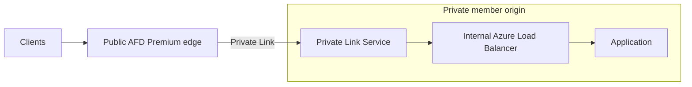
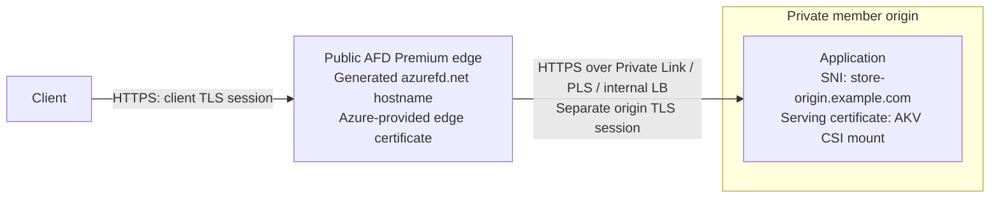

# Zero-Public-Exposure Ingress with Azure Front Door

> [!IMPORTANT]
> This guide describes the proposed GEP-1748 implementation on the
> `rchinchani/gep-1748-gateway-api` branch. The controller is not yet released.
> The manifests define the intended user contract and will become runnable as
> the implementation phases are completed.
> The explicitly enabled manager now reconciles the supported private HTTP
> graph, requests Private Link connections, and associates the Disabled route
> once its private backends are configured and provisioned. Pending or absent
> approval does not block that association or activation. After verifying the
> complete owned/private graph, Fleet enables the endpoint first, observes it,
> then enables and observes the route. Pending PLS requests still require
> authorized approval for connectivity; Fleet does not grant itself approval.
> Gateway/listener `Programmed=True` and hostname publication require the complete
> matching, enabled ARM configuration with accepted provisioning. They do not
> guarantee Private Link approval, edge propagation or application health.
>
> **Rationale:** our retained diagnostic delivered HTTP 200 from both private
> members while AFD origin approval remained null and endpoint/route/origin
> deployment remained `NotStarted`. Requiring those positive projections caused
> a controller deadlock. AFD approval null/Pending and deployment absent/
> NotStarted/InProgress are therefore advisory, not activation/readiness gates.
> Actual provisioning failures, rejection/disconnection/timeout, private-target
> drift, foreign ownership and unsupported inventory remain explicit failures.
> The Fleet activation tag records controller history, not Azure DNS validation.
> An already Enabled, pending-tag endpoint is adopted only after strict graph
> verification. The successful live traffic required user-performed enablement;
> the updated automatic controller path still needs a separately authorized live
> proof. Endpoint-first ordering follows that observed sequence, not a claim that
> Azure universally requires it.
>
> The approved first Azure execution subset is narrower than the full examples:
> one HTTP/80 listener with no hostname restriction, root `PathPrefix: /`,
> and one logical ServiceImport backend port across all rules. Backends must be
> in the HTTPRoute namespace; ReferenceGrants do not enable cross-namespace
> backends in this release. Cross-namespace HTTPRoute-to-Gateway attachment
> remains subject to listener `allowedRoutes`. Pure request
> construction now produces this complete graph with both endpoint and route
> disabled. The enabled manager uses the complete provider lifecycle rather
> than repeatedly replaying disabled-only staging. AFD remains disabled by
> default. Live Azure convergence, identity/permissions, private HTTP delivery,
> Host/probe behavior, withdrawal and cleanup must still be proven in a separately
> authorized run before release or operational-readiness claims.
> Hostname/custom-domain routing, Exact/non-root paths, multiple
> logical backends, filters and WAF association remain outside that execution
> subset and are explicitly left unprogrammed. The hostname-based examples
> below still describe the future contract, not a working deployment today.

The Gateway controller shares the platform Azure cloud-config read/write rate
limits across its AFD clients. Local token exhaustion waits within the existing
request context instead of repeatedly restarting graph reconciliation; it does
not raise QPS/bursts or bypass Azure HTTP 429 handling and SDK retries. Cancellation
or an insufficient request budget returns an error, never a readiness result.
These locally verified retry/teardown fixes still require a new authorized live
proof; they do not establish end-to-end ingress readiness.

This guide describes **Zero-Public-Exposure Ingress**, the Fleet product solution
for multi-cluster application ingress through Azure Front Door (AFD) Premium.
The only supported origin topology is **AFD with Private Link to internal load
balancers**:



Zero public exposure applies to member application origins: they have no public
load balancer frontend or public origin endpoint. AFD remains the public
client-facing edge. Public member origins and AFD Standard are not supported;
Standard does not support Private Link origins.

<!-- Decision: Private Link is the only supported origin topology and requires
AFD Premium. Connectivity and SKU are product constraints, not customer choices. -->

The solution uses:

- Gateway API resources in the Fleet hub.
- A Fleet `ServiceImport` as the only supported `HTTPRoute` backend.
- A matching `Service` and `ServiceExport` in every participating member
  cluster.
- Optional attachment to an existing Azure Front Door WAF policy.

The existing examples configure HTTP listeners. The
[proposed end-to-end TLS workflow](#proposed-https-origins) adds HTTPS on both
connections using the generated AFD client hostname and separate member
certificates. It is not supported by the merged HTTP implementation.

> [!IMPORTANT]
> **AFD Private Link approval is asynchronous and is a provisioning dependency.**
> Creating a Gateway or PLS does not mean traffic is ready. An authorized owner
> must approve each required connection, then independently verify private
> connectivity and delivery. Approval automation with the AFD and PLS teams is
> an open action item, not an available capability. See
> [Approve the AFD private endpoint connections](#4-approve-the-afd-private-endpoint-connections).

## Optional Traffic Manager resilience

**Azure Traffic Manager (ATM) is not a prerequisite for this solution.** For an
explicitly enabled AFD deployment, AFD-only is the default: customers do not need
to create Traffic Manager profiles/backends or configure a standby ingress.

> [!NOTE]
> Fleet's ATM-to-AFD ingress composition is not implemented. There is currently
> no supported Gateway annotation that enables it. The existing Traffic Manager
> ServiceImport backend integration is a different feature, not a prerequisite
> or an automatic failover layer for AFD.

AFD-only uses AFD's built-in resilience and eligible private member origins; it
does not provide an independent path around an AFD-wide outage. The separate
[optional ATM resilience proposal](../design/gep-1748-optional-atm-resilience.md)
describes future opt-in infrastructure, certificates, monitoring and failover
expectations. Those additional requirements do not apply to the standard setup
or block the planned AFD-only HTTPS implementation.

## Common prerequisites

> [!IMPORTANT]
> This integration requires a Fleet Manager with a managed hub. Hubless Fleet Manager resources
> do not have the Kubernetes configuration plane or hub-side `ServiceImport` aggregation used by
> the Gateway controller. Upgrade a hubless Fleet Manager by enabling its hub and reconciling
> existing members before following this guide. The upgrade cannot be reversed.

Before configuring the solution:

1. Confirm that the Fleet Manager has a managed hub. For a hubless Fleet Manager, follow the
   [hub upgrade guidance](https://learn.microsoft.com/azure/kubernetes-fleet/upgrade-hub-cluster-type)
   and reconcile its existing members.
2. Register every workload cluster as a healthy member of the same Fleet.
3. Install the Fleet hub and member networking controllers.
   Install the updated InternalServiceExport CRD on the hub first, then enable
   member `enablePrivateLinkOriginDiscovery` with Azure read permissions. This
   setting is independent of Traffic Manager. See the
   [member chart discovery guide](../../charts/member-net-controller-manager/README.md#private-origin-discovery-for-zero-public-exposure-ingress).
4. Install Gateway API `v1.2.1` CRDs in the Fleet hub.
5. Install the proposed `hub-gateway-controller-manager` in the Fleet hub using
   the [independent chart guide](../../charts/hub-gateway-controller-manager/README.md).
   The chart requires an explicit image, defaults to AFD disabled, and references
   an existing platform-owned Azure cloud-config Secret when enabled. It packages
   the opt-in private HTTP provisioning/observation/owned-cleanup runtime.
   Enabling it now authorizes controller AFD writes for supported Gateway intent;
   it is not an observation-only mode and does not itself prove live delivery.
6. Configure the controller with:
   - An Azure subscription.
   - A controller-wide AFD resource group.
   - An approved workload or managed identity.
   - Permission to manage AFD resources in the configured resource group.
   - Hub Gateway controller identity permission
     `Microsoft.Network/privateLinkServices/read` on every linked member PLS.
     AFD resource-group access alone (for example, CDN Profile Contributor)
     does not grant this linked-resource permission. For least privilege, an
     authorized platform owner can assign Reader on each actual PLS resource
     once it exists, before origin provisioning. This is separate from member
     discovery permissions and grants no connection-approval capability.
   - AFD Premium and Private Link-only origins as mandatory product settings.
7. Confirm the platform-installed GatewayClass is accepted:

   ```bash
   kubectl get gatewayclass azure-fleet-afd
   ```

   Expected status:

   ```text
   NAME              CONTROLLER                          ACCEPTED
   azure-fleet-afd   networking.fleet.azure.com/afd     True
   ```

The examples use these placeholders:

| Placeholder | Description |
|---|---|
| `${MEMBER_CONTEXT}` | `kubectl` context for one Fleet member cluster. |
| `${HUB_CONTEXT}` | `kubectl` context for the Fleet hub. |
| `${NAMESPACE}` | Application namespace, such as `store`. |
| `${SERVICE_NAME}` | Service and ServiceExport name, such as `store-api`. |
| `${APP_HOSTNAME}` | Public application hostname, such as `store.example.com`. |
| `${WAF_POLICY_ID}` | Optional full resource ID of an existing AFD WAF policy. |

Repeat the member-cluster steps for every cluster that should contribute an
origin to the multi-cluster service.

## Responsibility and resource placement

| Configuration or action | Applied or performed by | Where |
|---|---|---|
| Install Gateway API CRDs | Fleet platform operator | Fleet hub |
| Install and configure `hub-gateway-controller-manager` | Fleet platform operator | Fleet hub |
| Create `GatewayClass/azure-fleet-afd` | Fleet platform operator, normally through the controller Helm chart | Fleet hub; cluster-scoped |
| Configure controller subscription, AFD resource group, identity, and feature flag | Fleet platform operator | Gateway controller deployment in the Fleet hub |
| Grant AFD and origin-discovery Azure permissions | Azure subscription or resource-group owner | Azure RBAC |
| Deploy application workload | Application team or Fleet placement controller | Every selected member cluster |
| Create the application `Service` and `ServiceExport` | Application team or Fleet placement controller | Every selected member cluster |
| Create the internal Load Balancer and PLS | AKS cloud provider, in response to the member `Service` annotations | Azure resources associated with each member cluster |
| Create and aggregate `ServiceImport` | Fleet networking controllers | Fleet hub |
| Own Private Link-only origin policy and health-probe configuration | Fleet platform operator | Gateway controller configuration; no customer ServiceImport edits |
| Create `Gateway` and `HTTPRoute` | Fleet platform operator or authorized ingress owner | Fleet hub |
| Create and maintain WAF policy | Security owner | Azure |
| Add the optional WAF policy annotation to `Gateway` | Fleet platform operator or authorized ingress owner after authorization from the security owner | Fleet hub |
| Create and reconcile AFD resources | Hub Gateway controller | Azure, in the configured AFD resource group |
| Approve AFD-to-PLS private endpoint connections | Network or security owner | Azure PLS for each member cluster |
| Create application DNS records | DNS owner | Authoritative public DNS zone |

Customers do not create or annotate `ServiceImport` directly. Fleet creates it
from matching member-cluster exports. Application teams need access only to
their member-cluster resources; the platform operator or an authorized ingress
owner performs the hub-side steps below.

Private Link is mandatory without a connectivity annotation. Health-probe
settings are controller/platform-owned rather than required customer
configuration on a generated ServiceImport. This guide does not require a
customer-selected probe path.

The approved initial HTTP-preview policy is HTTP `GET /` every 30 seconds on the
selected ServiceImport backend port. Forwarded application requests preserve the
incoming Host header by omitting the optional ARM `originHostHeader` property,
as described in [AFD origin host header behavior](https://learn.microsoft.com/azure/frontdoor/origin#origin-host-header).
An explicit empty string is not equivalent: Azure rejects that request.
An observed nonempty override remains unready and requires explicit platform
repair; the controller does not assume an omitted PATCH field clears it.
Applications must return HTTP 200 to the probes. The controller programs this
policy from the resolver's desired backend; live request/probe Host behavior
remains a provider-verification gate. Probes are
sent from distributed AFD edge locations, so the aggregate rate can exceed one
request per 30 seconds.

<!-- Decision: Do not require afd-origin-connectivity or afd-health-probe-path
annotations on ServiceImport. Customers may not have access to the hub, and
Fleet owns these generated resources. Private Link is mandatory. If configurable
probe settings or other backend settings are needed later, consider a
platform-owned ConfigMap; its schema, scope, defaults, and reconciliation are
future design work, not a supported configuration API today. -->

## Configure AFD with Private Link to internal load balancers

In this topology, each member application is exposed through an internal Azure
Load Balancer and an Azure Private Link Service (PLS). AFD Premium creates a
private endpoint connection to each PLS. The member Services are not exposed as
public origins.

This is the only supported topology for Zero-Public-Exposure Ingress and is
intended to support SFI-NS253 because the member workloads do not require public
IP addresses. The current PR provides discovery, private backend resolution and
control-plane reconcilers; it does not yet implement or certify the complete
Private Link data path.

### 1. Create an internal LoadBalancer Service and PLS in each member cluster

**Actor:** Application team or Fleet placement controller

**Target:** Every participating member cluster

```yaml
apiVersion: v1
kind: Service
metadata:
  name: store-api
  namespace: store
  annotations:
    service.beta.kubernetes.io/azure-load-balancer-internal: "true"
    service.beta.kubernetes.io/azure-pls-create: "true"
    service.beta.kubernetes.io/azure-pls-name: store-api-pls
spec:
  type: LoadBalancer
  selector:
    app: store-api
  ports:
  - name: http
    protocol: TCP
    port: 8080
    targetPort: 8080
---
apiVersion: networking.fleet.azure.com/v1alpha1
kind: ServiceExport
metadata:
  name: store-api
  namespace: store
```

Apply the manifest to every private-backend member cluster:

```bash
kubectl --context "${MEMBER_CONTEXT}" apply -f private-backend.yaml
```

Verify that the Service address is private and the export is valid:

```bash
kubectl --context "${MEMBER_CONTEXT}" \
  --namespace "${NAMESPACE}" get service "${SERVICE_NAME}" -o wide

kubectl --context "${MEMBER_CONTEXT}" \
  --namespace "${NAMESPACE}" get serviceexport "${SERVICE_NAME}" -o yaml
```

Do not continue until each `ServiceExport` reports `Valid=True` and
`Conflict=False`.

Also verify that Azure created the PLS in the AKS node resource group:

```bash
az network private-link-service show \
  --resource-group "${AKS_NODE_RESOURCE_GROUP}" \
  --name store-api-pls \
  --query "{id:id,provisioningState:provisioningState}" \
  --output yaml
```

The AKS cloud provider creates the internal load balancer and PLS. With private
origin discovery enabled, the member networking controller discovers the PLS
resource ID, Azure location, internal IP, and provisioning readiness and
transports them in `InternalServiceExport.spec.privateLinkOrigin`. These fields
are not added to public `ServiceImport.status`. Discovery readiness does not
represent approval of an AFD private endpoint connection.

Members without ready private discovery contribute no origin; remaining ready
private members continue serving. If none remain, Fleet withdraws the owned
route and origins rather than falling back to public connectivity. Malformed
source identity, conflicting exports or public topology still fail closed.

### Member and ServiceExport lifecycle

An origin requires an active exporting member in `ServiceImport.status.clusters`,
its non-deleting reserved hub namespace, a current matching InternalServiceExport,
and ready private discovery. Joining a Fleet alone does not create an origin.
ServiceExport and member changes reuse the existing export bridge and dependency
watches; delayed aggregation/discovery does not withdraw other eligible members.

Fleet adds new/re-exported bindings before pruning verified retired origins,
without disabling the remaining private graph. A changed Service UID or PLS
binding gets a new origin identity. After the last eligible origin disappears,
Fleet disables the endpoint, removes its owned route, then removes retired
origins through bounded operations. The profile, Disabled endpoint and empty
origin group remain reusable for re-export; Gateway deletion still performs
owned-profile cleanup. Unknown/foreign resources are never blindly deleted.

<!-- Decision: Source lifecycle, not stale AFD approval projections, determines
origin membership. Retain Disabled roots for re-export and stable hostname. -->

### 2. Create the Premium AFD Gateway and route

**Actor:** Fleet platform operator or authorized ingress owner

**Target:** Fleet hub

Only AFD Premium is supported. The explicit SKU below records that mandatory
setting; Standard is not an alternative:

```yaml
apiVersion: gateway.networking.k8s.io/v1
kind: Gateway
metadata:
  name: store-private-global
  namespace: store
  annotations:
    networking.fleet.azure.com/afd-sku: Premium_AzureFrontDoor
spec:
  gatewayClassName: azure-fleet-afd
  listeners:
  - name: http
    protocol: HTTP
    port: 80
    hostname: store.example.com
    allowedRoutes:
      namespaces:
        from: Same
---
apiVersion: gateway.networking.k8s.io/v1
kind: HTTPRoute
metadata:
  name: store-private-api
  namespace: store
spec:
  parentRefs:
  - name: store-private-global
    sectionName: http
  hostnames:
  - store.example.com
  rules:
  - matches:
    - path:
        type: PathPrefix
        value: /
    backendRefs:
    - group: networking.fleet.azure.com
      kind: ServiceImport
      name: store-api
      port: 8080
      weight: 100
```

Apply the resources to the hub:

```bash
kubectl --context "${HUB_CONTEXT}" apply -f private-gateway.yaml
```

The Fleet group in `backendRefs` is intentional. This implementation follows
the GEP-1748 behavior while preserving the existing
`networking.fleet.azure.com/v1alpha1 ServiceImport` API.

The intended controller must reject an incompatible SKU or origin topology
explicitly rather than downgrade to public connectivity.

### 3. Optionally attach WAF to the private Gateway

**Actors:** Security owner creates and maintains the policy; Fleet platform
operator or authorized ingress owner attaches the approved policy

**Targets:** WAF policy in Azure; annotation on the `Gateway` in the Fleet hub

Attach an existing AFD Premium-compatible WAF policy:

```bash
kubectl --context "${HUB_CONTEXT}" \
  --namespace "${NAMESPACE}" annotate gateway store-private-global \
  networking.fleet.azure.com/afd-waf-policy-id="${WAF_POLICY_ID}" \
  --overwrite
```

WAF is optional and attached at the Gateway, not at an individual route.
The controller creates only the AFD security-policy association; it does not
create, modify, or delete the external WAF policy. Removing the annotation
removes only the AFD association.

### 4. Approve the AFD private endpoint connections

**Actor:** Network or security owner

**Target:** Each member cluster's PLS in Azure

> [!IMPORTANT]
> **AFD Private Link approval is asynchronous.** AFD must first create a
> connection request, which can remain pending until the PLS owner approves it.
> An empty pending-connection list does not prove approval or readiness; the
> request may not yet be visible. Approval is required for every connection
> used by the intended topology. AFD's origin status may remain null or Pending
> even after backend-side approval and working traffic; it is not a reliable
> confirmation signal.

**Open action item:** Work with the AFD and PLS teams to automate connection
approval while preserving PLS-owner authorization. Until that integration is
implemented and validated, plan for the manual approval step below. Do not
assume automatic approval is available.

<!-- Decision: Approval automation is an outstanding dependency with the AFD
and PLS teams. Keep the authorized manual workflow until automation and its
ownership/trust boundary are defined and validated. -->

Repeat this process for the PLS in every participating member cluster.

Get the PLS resource ID:

```bash
export PLS_ID=$(az network private-link-service show \
  --resource-group "${AKS_NODE_RESOURCE_GROUP}" \
  --name store-api-pls \
  --query id \
  --output tsv)
```

List pending private endpoint connections:

```bash
az network private-endpoint-connection list \
  --id "${PLS_ID}" \
  --query "[?privateLinkServiceConnectionState.status=='Pending'].{name:name,id:id}" \
  --output table
```

Approve each connection after verifying that its request belongs to the
controller-owned AFD origin:

```bash
az network private-endpoint-connection approve \
  --id "${PRIVATE_ENDPOINT_CONNECTION_ID}" \
  --description "Approve Fleet Gateway AFD origin"
```

Do not configure broad PLS auto-approval unless the platform security owner has
approved that trust boundary.

After submitting approval, observe the connection state and AFD/Gateway status;
the approval command succeeding does not mean the data path is ready.

### 5. Verify the private configuration

**Actor:** Fleet platform operator, network owner, or authorized ingress owner

**Targets:** Gateway API status in the Fleet hub, AFD resources, and member PLS
connections in Azure

```bash
kubectl --context "${HUB_CONTEXT}" \
  --namespace "${NAMESPACE}" get gateway store-private-global -o yaml

kubectl --context "${HUB_CONTEXT}" \
  --namespace "${NAMESPACE}" get httproute store-private-api -o yaml
```

Private Link approval diagnostics are independent of configured programming.
`ResolvedRefs=True` validates the supported backend reference; `Programmed=True`
validates the owned, matching, enabled configuration, not successful traffic.
Verify the configuration and separately approve/inspect the exact backend-side
connections and test application delivery:

- Gateway `Accepted=True`.
- Gateway `Programmed=True`.
- Listener `Programmed=True`.
- HTTPRoute parent `Accepted=True`.
- HTTPRoute parent `ResolvedRefs=True`.
- Every AFD origin uses Private Link.
- No public AFD origin was created for the ServiceImport.
- Gateway `status.addresses` contains the AFD endpoint hostname.

Do not wait for AFD origin approval or `deploymentStatus=Succeeded` as a substitute
for traffic/probe evidence. Probe the configured protocol with fresh request
identifiers, verify expected member responses and Host preservation, and inspect
actual health-probe behavior. A generated `azurefd.net` hostname needs no custom
domain `_dnsauth` record. WAF/security-policy association is not required for
Private Link/basic AFD routing, but is outside the current Fleet execution subset.

The [Microsoft Q&A customer report](https://learn.microsoft.com/en-us/answers/questions/5988188/azure-front-door-premium-deployment-stuck-at-notst)
also describes HTTP 200 despite `NotStarted`/Pending projections. Our own ILB/PLS
diagnostic independently reproduced working traffic with null approval; neither
observation promises universal propagation timing.

The DNS owner creates the public DNS record for `${APP_HOSTNAME}` only after
the Gateway reports its AFD hostname. Follow the controller's status and
instructions for DNS ownership and custom-domain validation.

## Proposed HTTPS origins

> [!IMPORTANT]
> **Experimental branch capability, default off; not released or live-certified.**
> The [HTTPS-origin design](../design/gep-1748-https-origins-proposal.md)
> defines this end-to-end TLS UX, including HTTPS at the AFD edge. Do not apply
> these manifests to older HTTP-only controllers or infer production readiness
> from offline tests.
> The initial client-facing name is AFD's generated hostname; custom client
> domains and their DNS/certificate lifecycle remain deferred.

The platform must first upgrade the hub's InternalServiceExport CRD, install the
pinned Gateway API v1.2.1 experimental BackendTLSPolicy CRD in hub and members, and
set `enableOriginTLS=true` in both existing manager charts. The member also needs
`enablePrivateLinkOriginDiscovery=true`; the hub needs `afd.enabled=true`.
The equivalent manager flag is `--enable-origin-tls=true`. Startup checks reject
missing prerequisites; TLS-off HTTP deployments do not need the experimental CRD.
See the [member chart](../../charts/member-net-controller-manager/README.md#opt-in-https-origin-metadata)
and [hub chart](../../charts/hub-gateway-controller-manager/README.md#opt-in-https-installation-and-upgrade)
for installation, upgrade and disable ordering.

Member TLS intent is refreshed about every minute and expires after five minutes
without a matching observation. Metadata-only policy opt-out is watched without
requiring a policy generation change. Revocation is not instantaneous: member/hub
reconciliation and AFD propagation/in-flight requests still apply. The hub reports
excluded members/reasons and reduced capacity in existing Gateway status; it
publishes an address only after full owned-origin inventory excludes those members.
Before disabling or downgrading the hub, withdraw HTTPS routing and observe cleanup.

**Customers touch member clusters only.** Application teams configure member
workloads, application-owned certificate delivery, Services, ServiceExports and Service-targeted
BackendTLSPolicies explicitly opted into Fleet export. Fleet validates/aggregates
their non-secret TLS intent and automatically creates the hub
ServiceImport-targeted policy. Customers and
operators never hand-author that projection or annotate generated ServiceImports.
The platform operator owns hub Gateway/HTTPRoute authorization and hub reads,
then supplies the HTTPS URL/readiness evidence through the existing channel.
No customer hub credentials are needed. Network owners separately approve
Private Link connections; this grants customers no extra Azure privileges.

A ServiceExport or member TLS policy alone does not create an AFD endpoint or
authorize ingress. The platform's Gateway/HTTPRoute must explicitly reference
the backend. TLS identity changes thereafter come from member policy updates,
not manual hub policy edits.



AFD terminates client TLS and opens a separate TLS connection to the application;
this is not TLS passthrough. Azure supplies and renews the edge certificate for
the generated hostname, for example `store-abc.z01.azurefd.net`. Customers do not
upload an edge certificate, configure public client DNS or copy their member key
to the hub. The member certificate is separate and still needs application-owned
issuance, secure storage, reload and renewal. The generated hostname is not a
customer-owned name such as `store.example.com`; that is outside this subset.
Treat the operator-provided URL as deployment output. It remains the same while
the AFD endpoint is retained; normal reconciliation and member join/leave must
not rotate it. Endpoint/Gateway replacement may change it, requiring the
operator to hand off a new URL and client owners to update their configuration.

A stable custom domain is a production requirement when clients must retain
the same application URL across endpoint replacement. That support remains a
follow-up, not a feature of these examples. It needs coordinated DNS ownership,
AFD domain validation/routing, edge certificate provisioning/renewal and tested
replacement cutover/recovery; adding a CNAME alone does not configure HTTPS.
Customers would still use only member-cluster Kubernetes access, with platform
operators coordinating hub/AFD changes and authorized DNS/certificate owners.
If a replacement-independent URL is required, this generated-domain subset
does not yet meet that requirement.

This keeps the [MCS ownership model](https://multicluster.sigs.k8s.io/concepts/multicluster-services-api/)
and adds no TLS fields to ServiceExport or ServiceImport. These examples use
Fleet's existing API group; they do not imply upstream MCS wire compatibility.

Before onboarding, complete the [customer readiness checklist](#customer-readiness-checklist).
It assigns owners and required evidence for controller/CRD versions, Azure and
Kubernetes permissions, private networking/approval, application TLS and probes,
certificate issuance/rotation, monitoring, migration and teardown. Successful
manifest application is not sufficient.

The proposed customer tasks are:

- [Prepare member resources and complete the operator handoff](#proposed-setup-order).
- [Verify both TLS connections with curl and member logs](#proposed-verification-and-operational-expectations).
- [Renew certificates or change origin identity](#proposed-certificate-renewal-and-identity-changes).
- [Add or remove an exporting member](#proposed-member-lifecycle).
- [Troubleshoot failures](#proposed-https-origin-troubleshooting).
- [Remove the TLS configuration safely](#proposed-https-origin-cleanup).

### Proposed member step: serve and export TLS

**Actors:** Application team and certificate owner

**Target:** Every participating member cluster

Provision a certificate for a shared origin identity such as
`store-origin.example.com` and configure the application to serve TLS on port
8443. Each member can use a separate certificate/key for that identity.
Serve the complete leaf/intermediate chain rooted in an AFD-trusted public CA;
self-signed or internal-CA certificates do not work with this proposal.
Use existing application certificate tooling for issuance, secure storage,
reload, expiry monitoring and renewal; Fleet does not distribute private keys.

#### Configure the serving certificate at the application

| Item | Where configured |
|---|---|
| Origin certificate chain and matching private key | Application-owned AKV certificate mounted into each member pod using Secrets Store CSI |
| Certificate name/SNI that AFD must validate | Each member's Service-targeted BackendTLSPolicy `validation.hostname`; Fleet projects agreeing intent into the hub |
| Accepted certificate issuers | Policy `wellKnownCACertificates: System`, meaning AFD's trust store |
| Client-facing AFD certificate | Azure-provided/renewed certificate for the generated AFD hostname, selected by the operator's HTTPS listener |

For this example, first create namespace `store` in each selected member if it
does not exist. The platform/certificate owner must already provide:

- Secrets Store CSI Driver and Azure Key Vault provider on each member, with
  CSI token requests for `api://AzureADTokenExchange` and a configured OIDC issuer.
- An Entra Workload Identity with least-privilege secret-read access to the
  approved certificate's backing secret, and AKV network access from each member.
- A federated credential for **each member's issuer**, exact subject
  `system:serviceaccount:store:store-origin`, and that audience.
- An exportable server certificate and full intermediate chain in AKV. Select
  `objectType: secret`, not `cert` (public certificate only) or `key` (public key).
  CSI cannot bypass non-exportable/HSM key policy.

Use your controlled DNS name instead of `store-origin.example.com`. Replace the
AKV name, backing-secret name, tenant ID and identity client ID placeholders in
the YAML before applying it. These are identifiers, not credentials. The example
uses the latest secret version; set `objectVersion` to an approved backing-secret
version when pinning is required. Different members may reference different
vaults, identities or keys for the same DNS identity.

The following illustrative NGINX application mounts one PEM bundle containing
the private key and leaf/intermediate chain, without Kubernetes Secret sync or
runner-local key files. CSI-native Workload Identity uses the pod's ServiceAccount
and SPC `clientID`; no application SDK token injection, ServiceAccount annotation
or pod workload-identity label is required for this CSI-only use.
See the [provider Workload Identity guidance](https://azure.github.io/secrets-store-csi-driver-provider-azure/docs/configurations/identity-access-modes/workload-identity-mode/).
It is the application, not an additional Fleet
ingress proxy. Existing applications should configure their own TLS stack
instead of replacing their workload with this example. Select an approved,
pinned image for production.

```yaml
apiVersion: v1
kind: ServiceAccount
metadata:
  name: store-origin
  namespace: store
automountServiceAccountToken: false
---
apiVersion: secrets-store.csi.x-k8s.io/v1
kind: SecretProviderClass
metadata:
  name: store-origin-tls
  namespace: store
spec:
  provider: azure
  parameters:
    usePodIdentity: "false"
    useVMManagedIdentity: "false"
    clientID: "<workload-identity-client-id>"
    keyvaultName: "<approved-akv-name>"
    tenantId: "<tenant-id>"
    objects: |
      array:
        - |
          objectName: <certificate-backing-secret-name>
          objectType: secret
          objectFormat: pem
          objectAlias: serving.pem
          objectVersion: ""
          filePermission: "0400"
---
apiVersion: v1
kind: ConfigMap
metadata:
  name: store-api-nginx
  namespace: store
data:
  default.conf: |
    log_format origin_tls '$hostname tls=$ssl_protocol sni=$ssl_server_name '
                          'host=$http_host afd_ref=$http_x_azure_ref "$request"';
    access_log /var/log/nginx/access.log origin_tls;

    server {
      listen 8443 ssl default_server;
      server_name store-origin.example.com;
      ssl_certificate     /etc/origin-tls/serving.pem;
      ssl_certificate_key /etc/origin-tls/serving.pem;
      ssl_protocols TLSv1.2 TLSv1.3;

      # Accept preserved Host and return 200 for AFD probes.
      location / {
        default_type text/plain;
        return 200 "store-api member=member-1 pod=$hostname\n";
      }
    }
---
apiVersion: apps/v1
kind: Deployment
metadata:
  name: store-api
  namespace: store
spec:
  replicas: 2
  selector:
    matchLabels:
      app: store-api
  template:
    metadata:
      labels:
        app: store-api
    spec:
      serviceAccountName: store-origin
      automountServiceAccountToken: false
      containers:
      - name: app
        image: nginx:stable-alpine # Illustrative; pin an approved digest.
        ports:
        - name: https
          containerPort: 8443
        volumeMounts:
        - name: origin-tls
          mountPath: /etc/origin-tls
          readOnly: true
        - name: nginx-config
          mountPath: /etc/nginx/conf.d
          readOnly: true
      volumes:
      - name: origin-tls
        csi:
          driver: secrets-store.csi.k8s.io
          readOnly: true
          volumeAttributes:
            secretProviderClass: store-origin-tls
      - name: nginx-config
        configMap:
          name: store-api-nginx
```

The ServiceAccount, SPC and mount are member-local; the hub policy never fetches
certificate contents. The root-owned `0400` bundle is readable by this example's
NGINX master; adapt ownership/permissions deliberately for a non-root application.
Arrange application reload or rolling replacement on renewal: CSI rotation
updates files only when configured and does not make NGINX reload its certificate.
Use a directory mount, not `subPath`, so atomic CSI updates remain visible.
Change `member=member-1` to the actual member identifier in each cluster's
ConfigMap so responses can distinguish sources. The example logs TLS version,
SNI, HTTP Host and request correlation for diagnosis; these values are not an
authorization mechanism. Configure application-appropriate readiness probes
and log retention before production use.

#### Export the private TLS Service

The proposed Service and existing ServiceExport retain the private topology:

```yaml
# Requires the experimental TLS capability in both member and hub managers.
apiVersion: v1
kind: Service
metadata:
  name: store-api
  namespace: store
  annotations:
    service.beta.kubernetes.io/azure-load-balancer-internal: "true"
    service.beta.kubernetes.io/azure-pls-create: "true"
    service.beta.kubernetes.io/azure-pls-name: store-api-pls
spec:
  type: LoadBalancer
  selector:
    app: store-api
  ports:
  - name: https
    protocol: TCP
    appProtocol: https # Declares TLS intent; does not provision a certificate.
    port: 8443 # HTTPRoute selects this Service port.
    targetPort: 8443 # The workload must already serve TLS here.
---
apiVersion: networking.fleet.azure.com/v1alpha1
kind: ServiceExport
metadata:
  name: store-api
  namespace: store
```

All members must export compatible ports/protocol intent. Fleet currently
compares the complete exported port lists, including `targetPort`; keep those
values consistent across members. AFD connects to Service port 8443, not directly
to targetPort. This example replaces the earlier HTTP Service only through a
coordinated migration, not an in-place change while the old HTTP route remains
active. Port 8443 is an example, not a required TLS port.

### Proposed member step: declare origin identity and trust

**Actor:** Customer application owner

**Target:** Every participating member, in the Service namespace

After the platform installs/enables the experimental member/hub capability and pinned
experimental BackendTLSPolicy CRDs, create this policy in each member:

```yaml
# Member policy; requires the platform-installed experimental policy CRD.
apiVersion: gateway.networking.k8s.io/v1alpha3
kind: BackendTLSPolicy
metadata:
  name: store-api-origin-tls
  namespace: store
  annotations:
    # Proposed Fleet export opt-in, not exclusive controller ownership.
    networking.fleet.azure.com/export-to-fleet: "true"
spec:
  targetRefs:
  - group: ""
    kind: Service # Local Service; never reference the hub import here.
    name: store-api
  validation:
    hostname: store-origin.example.com # SNI/certificate identity, not HTTP Host.
    wellKnownCACertificates: System # AFD's trust store, not the hub's.
```

This uses Gateway API's local Service target shape. Fleet-specific behavior is
the explicit policy export opt-in, cross-member aggregation and generated hub
ServiceImport-targeted policy; it is not a portable ServiceImport extension.
The target has exactly one
exported port and every eligible member must declare the same precise hostname and
`System` trust. Here `System` means AFD's trusted CA set, not a customer-uploaded
CA or either cluster's trust store. The policy includes no certificate keys.

BackendTLSPolicy has no `spec.controllerName`. The proposed annotation's exact
string `"true"` opts this member policy into Fleet export; an unmarked policy
used by another implementation, such as Istio, is not exported just because
its Service is exported. The annotation is not an exclusive controller selector:
another implementation may also consume the same policy, and Fleet does not
edit its policy fields or other-controller status.

For Fleet TLS eligibility, exactly one policy in the Service namespace may
target that core Service, and it must explicitly opt in. Multiple policies
make that member ineligible for AFD even if their settings match or only one is
opted in; an unmarked policy for another implementation still counts. Fleet
does not choose an oldest/newest policy or combine settings.

This is a stricter Fleet subset, not Gateway API's oldest-policy conflict
resolution or a cluster-wide admission restriction. Fleet does not delete/edit
other implementations' policies. Coordinate duplicate targets with their owners;
a single shared policy may serve both implementations if their requirements
agree. Removing duplicates must be followed by fresh validation and agreement
before Fleet re-admits that member's origin.

`caCertificateRefs` would configure trust anchors, not the application's serving
certificate/key; arbitrary CA references are unsupported by this AFD proposal.
The certificate/key mount remains at the workload. Fleet transports only validated
hostname/trust, resolution state, source identity/generation and observed export
opt-in through its internal export metadata; no new public ServiceExport/ServiceImport fields.
Missing, unmarked, duplicate, invalid, unreadable or stale policy intent excludes
that member from AFD eligibility, not baseline MCS networking. Fleet records the
member/reason and verifies its exact origin absent or administratively disabled/
removed before continuing service through agreeing eligible members. It never
silently omits a source, assumes a hostname for an older member or treats a failed
health probe as administrative isolation.

All otherwise eligible, locally valid member intents must agree on the shared
TLS hostname/trust/port. Conflicting valid identities withdraw the affected route;
Fleet does not choose a majority or exclude a valid identity to manufacture
agreement. No eligible origins, incomplete authoritative source inventory,
shared dependency/ownership errors or inability to verify safe origin isolation
also require route withdrawal/suspension. Isolation and propagation are
asynchronous; errors and temporary suspension remain possible.
If Azure errors also prevent suspension, operators must escalate the explicit
enforcement failure; a requested withdrawal is not proof that traffic stopped.

Customers never apply/edit/delete the generated hub policy. Fleet owns its
creation, updates, drift repair and cleanup, based on current eligible-member
agreement and verified exclusion provenance.
Read failures/partitions cannot preserve authorization indefinitely; bounded
freshness behavior still needs implementation review and testing.
Removing/changing the member policy's export annotation withdraws that member's
TLS authority and requires origin isolation, not automatic global withdrawal,
HTTP fallback or changes to baseline MCS exports. Annotation-only changes must
be observed even though generation does not change. The hub projection needs no
customer export marker. Operators report exclusions, isolation state and
degraded capacity through existing diagnostics and the platform handoff.

### Proposed operator step: authorize ingress

For completeness, the operator-owned end-to-end TLS Gateway and HTTPRoute are:

```yaml
apiVersion: gateway.networking.k8s.io/v1
kind: Gateway
metadata:
  name: store-private-global
  namespace: store
  annotations:
    networking.fleet.azure.com/afd-sku: Premium_AzureFrontDoor
spec:
  gatewayClassName: azure-fleet-afd
  listeners:
  - name: https
    protocol: HTTPS
    port: 443
    tls:
      mode: Terminate # AFD opens a separate TLS connection to the origin.
      options:
        networking.fleet.azure.com/afd-default-certificate: "true"
    allowedRoutes:
      namespaces:
        from: Same
---
apiVersion: gateway.networking.k8s.io/v1
kind: HTTPRoute
metadata:
  name: store-private-api
  namespace: store
spec:
  parentRefs:
  - name: store-private-global
    sectionName: https
  rules:
  - matches:
    - path:
        type: PathPrefix
        value: /
    backendRefs:
    - group: networking.fleet.azure.com
      kind: ServiceImport # Created by Fleet, not applied by the customer.
      name: store-api
      port: 8443
```

The HTTPRoute keeps its existing Fleet ServiceImport backend shape and selects
the origin TLS port independently of edge port 443. The proposed domain-prefixed
`tls.options` entry selects Azure's certificate for the generated AFD hostname,
not a member certificate or a hub Secret. This is a Fleet-specific Gateway API
extension; no MCS field changes. It satisfies the pinned Gateway TLS schema's
nonempty-options alternative to certificate references; branch envtest checks
admission and controller reconciliation. No `certificateRefs`, explicit listener/route
hostnames, extra listener, custom domain or passthrough is supported here.

The operator/controller must configure accepted edge protocols as HTTPS only,
associate the default domain and leave HTTP redirection disabled. It separately
uses HTTPS-only forwarding and HTTPS `GET /` probes on the selected backend port,
with certificate-name checks enforced. HTTP is not an implicit alternate path
on either hop. Existing explicit HTTP-preview deployments remain unchanged.
Application requests preserve the generated AFD Host independently of origin
SNI. The application must accept that Host and return 200 to actual AFD probes.
Probe Host/SNI behavior must be verified before release.

### Proposed setup order

**Actors:** Customer application/certificate owner in members; platform operator
in the hub; PLS owner in Azure

This sequence requires the **experimental TLS-enabled branch images, not the
current released HTTP-only images**. It has not been live-certified. Customers
use only `${MEMBER_CONTEXT}`. Only the operator
uses `${HUB_CONTEXT}` in steps explicitly assigned below. The example namespace
is `store`. Do not reuse these names over an existing deployment without a
migration plan.

Save the preceding YAML blocks as follows, after replacing the domain, member
identifier and illustrative image as appropriate:

| File | YAML contents | Actor and target |
|---|---|---|
| `origin-tls-workload.yaml` | ServiceAccount, SecretProviderClass, ConfigMap and Deployment | Customer, each member |
| `private-tls-service.yaml` | Service and ServiceExport | Customer, each member |
| `origin-tls-policy.yaml` | BackendTLSPolicy targeting Service | Customer, each member |
| `private-origin-tls-gateway.yaml` | Gateway and HTTPRoute | Platform operator, hub only |

1. The platform operator installs the TLS-capable candidate member/hub images,
   updated internal transport CRD in the hub first, pinned policy CRDs in the
   hub and members, and scoped RBAC, then explicitly enables the capability. No
   automatic production enablement is implied. Set both charts'
   `enableOriginTLS=true` (manager flag `--enable-origin-tls=true`).
   Confirm managed hub membership,
   GatewayClass acceptance and member private discovery using the prerequisites
   above. The operator verifies the policy CRD in the hub and every member:

   ```bash
   kubectl --context "${HUB_CONTEXT}" \
     get crd backendtlspolicies.gateway.networking.k8s.io
   kubectl --context "${MEMBER_CONTEXT}" \
     get crd backendtlspolicies.gateway.networking.k8s.io
   ```

2. The customer ensures namespace `store` exists in every member and the
   operator has prepared AKV/CSI/federation as above, then applies its workload, policy and
   export files with matching hostname/trust and explicit policy export opt-in
   in all participating members:

   ```bash
   kubectl --context "${MEMBER_CONTEXT}" --namespace store \
     apply -f origin-tls-workload.yaml -f origin-tls-policy.yaml \
       -f private-tls-service.yaml
   kubectl --context "${MEMBER_CONTEXT}" --namespace store \
     rollout status deployment/store-api
   kubectl --context "${MEMBER_CONTEXT}" --namespace store \
     get service/store-api serviceexport/store-api -o yaml
   kubectl --context "${MEMBER_CONTEXT}" --namespace store \
     describe backendtlspolicy store-api-origin-tls
   ```

   Expect the private Service address, `Valid=True` and `Conflict=False`.
   Check actual certificate presentation with the private preflight below;
   Deployment availability alone does not prove a trusted TLS handshake.
   Member policy events diagnose local selection/transport errors, not complete
   hub convergence. Do not expect fabricated top-level policy conditions or
   a member policy ancestor referencing a Gateway in another cluster.

3. The platform operator authorizes this logical service for ingress, ensures
   namespace `store` exists in the hub, inspects the generated import and applies
   only the routing file. Fleet creates the hub policy automatically once the
   current eligible member intents agree and excluded origins are verified
   isolated; there is no hub-policy apply step:

   ```bash
   kubectl --context "${HUB_CONTEXT}" --namespace store \
     get serviceimport store-api -o yaml
   kubectl --context "${HUB_CONTEXT}" --namespace store \
     apply -f private-origin-tls-gateway.yaml
   ```

   Expect the intended active exporting members and compatible HTTPS port
   metadata. Fleet currently puts imported port metadata in `status.ports`.
   Do not add a new ServiceImport spec or patch its status to make this work.

4. The PLS owner verifies and approves each exact AFD-to-PLS connection using
   [the existing approval procedure](#4-approve-the-afd-private-endpoint-connections).
   The operator performs the configuration and both-hop TLS checks below, then
   supplies the observed `https://<AFD-hostname>/` URL and sanitized readiness
   evidence to the customer. Policy creation, CRD presence and an approval
   command's success are not traffic proof. No hub credential handoff is needed.

### Proposed verification and operational expectations

**Actors:** Platform/network owners for hub/Azure checks; customer for curl
and member application logs

The network owner still approves each exact AFD-to-PLS connection using the
existing manual workflow. The platform operator verifies policy acceptance,
HTTPRoute references, HTTPS listener and the observed owned TLS graph, then
separately proves client HTTPS, private HTTPS traffic/probes and both-member
delivery. Programmed does not certify a live handshake, certificate expiry,
approval or application health.

A member's missing/deleted/invalid policy or removed export opt-in requires
explicit isolation of that member's owned origin. Eligible members may continue
serving under one unambiguous TLS contract after isolation is verified. With
no eligible origins, conflicting valid TLS intent, shared failures or unsafe
isolation, withdraw/suspend the affected route. Never restore HTTP, remove the
ServiceExport or change baseline MCS membership/EndpointSlices.
Certificates with an untrusted chain, wrong name or expired validity fail TLS;
neither disabling certificate checks nor HTTP fallback is supported. AFD can
still send requests when all origins fail health probes, so probe failure is
not a traffic-blocking guarantee.

For same-hostname renewal, reload the new valid certificate at each workload
and verify fresh TLS connections. For an identity change, deploy certificates
covering both names everywhere before updating the policy, verify convergence
and traffic, then retire the old name. No public member endpoint, customer-issued
edge certificate, Traffic Manager deployment or hub private-key access is
required. Azure's default-domain edge certificate does not renew the member
certificates.

See the [TLS boundaries, migration and validation gates](../design/gep-1748-https-origins-proposal.md)
and the [customer-provided AFD TLS guidance](https://learn.microsoft.com/nb-no/AZURE/frontdoor/end-to-end-tls?pivots=front-door-standard-premium).

**Operator-only configuration checks.** Inspect configuration without assuming
that top-level policy conditions exist:
Generated hub BackendTLSPolicy acceptance is recorded under the real managed
Gateway's ancestor entry. The example generated name is derived from the target
import (`store-api-origin-tls`), not copied from an arbitrary member policy name.

```bash
kubectl --context "${HUB_CONTEXT}" --namespace store \
  get backendtlspolicy store-api-origin-tls -o yaml
kubectl --context "${HUB_CONTEXT}" --namespace store \
  get gateway store-private-global -o yaml
kubectl --context "${HUB_CONTEXT}" --namespace store \
  get httproute store-private-api -o yaml
```

Expected proposed configuration signals:

- Every authoritative source is accounted for as eligible or explicitly excluded;
  eligible intent agrees and source identities/freshness are verified. The
  generated policy matches that aggregate, exclusion provenance and target import.
- Excluded members have no owned origin or their exact origins are observed
  administratively disabled/removed, with member/reason/degraded-capacity
  diagnostics. Probe health alone does not prove isolation.
- The generated hub policy's real Gateway ancestor has `Accepted=True` for the
  current generation. Its prior acceptance alone is not current source authority.
- HTTPRoute parent `Accepted=True` and `ResolvedRefs=True`.
- HTTPS/443 listener with the supported default-certificate option, current
  `Programmed=True` and the observed generated AFD hostname in `status.addresses`.
- Observed owned AFD route accepts only HTTPS, links the default domain and
  does not enable HTTP redirection.
- Observed owned AFD origins/routes use the intended PLS targets, TLS hostname,
  HTTPS port, HTTPS-only forwarding/probes and certificate-name validation.

The operator retrieves the actual generated hostname for the customer handoff:

```bash
AFD_HOSTNAME=$(kubectl --context "${HUB_CONTEXT}" --namespace store \
  get gateway store-private-global -o jsonpath='{.status.addresses[0].value}')
test -n "${AFD_HOSTNAME}" || { echo "Gateway has no AFD hostname" >&2; exit 1; }
printf 'Customer URL: https://%s/\n' "${AFD_HOSTNAME}"
```

**Customer client check; no hub access.** Set `AFD_HOSTNAME` to the hostname the
operator supplied, without a scheme or path, then use plain `curl`:

```bash
AFD_HOSTNAME='<AFD hostname supplied by the platform operator>'
curl --verbose --fail-with-body --show-error "https://${AFD_HOSTNAME}/"
```

Curl must verify the edge certificate for that hostname using its normal trust
store. Do not substitute `store-origin.example.com`, override the Host header,
add `-k`/`--insecure` or rely on HTTP redirects. An edge certificate/trust error
is distinct from a successful edge handshake followed by an origin TLS error.

For correlated delivery proof, repeat with fresh request identifiers:

```bash
curl --verbose --fail-with-body --show-error --get \
  --data-urlencode "proof=$(date +%s)-${RANDOM}" \
  "https://${AFD_HOSTNAME}/"
```

Expect a `store-api member=... pod=...` response from the sample. Repeat with
fresh IDs and correlate application logs from each member:

```bash
kubectl --context "${MEMBER_CONTEXT}" --namespace store \
  logs -l app=store-api --all-containers=true --prefix --since=10m
```

Confirm both intended members, the policy SNI, negotiated TLS, incoming AFD Host
and matching request IDs. Separately observe real HTTPS health probes returning
200. Different successful responses alone do not prove the private target or
TLS settings; correlate the exact PLS binding, AFD evidence and application logs.
Fewer samples need not exercise every member, so stop and investigate rather
than declaring success after an arbitrary request count.

Curl's edge certificate verification proves the client-to-AFD TLS connection, not
the origin hop. Correlated member TLS/SNI logs and exact private bindings prove
the second connection. Both are required for an end-to-end claim. The operator
also verifies that fresh HTTP requests are not forwarded to the application;
an AFD error page is not a successful application response.

### Proposed certificate renewal and identity changes

**Actors:** Customer certificate/application owner in members; platform operator
for hub projection observation, not policy edits

For renewal with the same hostname, use the approved certificate automation to
create a new AKV certificate/backing-secret version. Verify its chain, key and
hostname without exposing private contents. If using a pinned version, update
that member's SPC `objectVersion` and apply it first. With an unpinned reference,
configured CSI autorotation can refresh the mount; without autorotation a fresh
pod mount retrieves the current version. Confirm the expected mounted version
through `SecretProviderClassPodStatus` and public certificate metadata.
Reload NGINX or roll out one member at a time:

```bash
kubectl --context "${MEMBER_CONTEXT}" --namespace store \
  rollout restart deployment/store-api
kubectl --context "${MEMBER_CONTEXT}" --namespace store \
  rollout status deployment/store-api
```

A rollout is one example reload method, not a zero-downtime guarantee. Never
render the mounted bundle, export private material into CI, or sync it to a
Kubernetes Secret just to trigger reload.
Verify the new certificate through direct private inspection and fresh
through-AFD TLS connections/requests before updating the next member. Keep
overlapping certificate validity and a verified rollback option. No policy edit
or hub certificate copy is needed for same-name renewal.

For an origin hostname change, deploy certificates covering both old and new
names to every participating member first. Update `validation.hostname` in
each member's `origin-tls-policy.yaml` and apply it in every member:

```bash
kubectl --context "${MEMBER_CONTEXT}" --namespace store \
  apply -f origin-tls-policy.yaml
```

Disagreement during a staggered update withdraws the affected AFD route;
coordinate a maintenance window, not a zero-downtime promise. Once all otherwise
eligible intents agree, Fleet updates the generated hub policy/AFD graph automatically. The
operator verifies the hub projection and the customer verifies member rollout,
new SNI and through-AFD responses. Only then retire old-name coverage. Do not
edit the generated hub policy, MCS schemas/status or public client DNS.
Record any excluded members; they cannot rejoin without fresh validation against
the current shared contract.

### Proposed member lifecycle

**Actors:** Application/placement owner and network owner

To add a member, the customer repeats the certificate/workload/export setup in
that cluster, including its matching opted-in local policy before export, and
verifies compatible exported ports/private discovery. A newly participating export
without current matching policy is explicitly excluded until ready. Verified
absence/isolation lets healthy members continue; a conflicting otherwise-valid
TLS identity instead makes the shared contract ambiguous and withdraws the route.
The
network owner approves any newly required correlated PLS connection; operators
and the customer then prove that member's response and TLS/probes.
Joining the Fleet alone does not add a ready origin.

To stop exporting this application from one member, delete only its export:

```bash
kubectl --context "${MEMBER_CONTEXT}" --namespace store \
  delete serviceexport store-api
```

Observe that Fleet retires that member's owned origin and remaining eligible
members still serve. Do not edit `ServiceImport.status.clusters`. Removing the
last eligible origin withdraws the AFD route/origins and disables the retained
endpoint; it does not make public/HTTP origins eligible. Keep the member Service
and certificate until withdrawal is confirmed. Re-exporting must repeat
eligibility, approval and traffic verification.

### Proposed HTTPS-origin troubleshooting

| Symptom | Check first | Safe response |
|---|---|---|
| Member policy cannot be created | Future member TLS-capable release, pinned experimental CRD and local namespace RBAC | Platform operator corrects installation; customer uses only member permissions, never new MCS TLS fields |
| Member intent unresolved or disagrees | Exact export opt-in, policy targets/counts, member identity/freshness, exclusion reason/isolation state and eligible hostname/trust agreement | Isolate a member-local policy failure and continue verified agreeing members. Coordinate duplicate targets with their owners. Conflicting valid identities, no eligible origins or unsafe isolation withdraw the affected route; never choose by age/majority or hand-edit the hub policy |
| Generated hub policy absent/conflicted | Current internal source UIDs/generations/freshness, target import, explicit routing and verified generated ownership | Operator resolves transport/ownership/routing failures; never adopt a foreign policy or edit generated MCS state |
| Export missing/conflicted or no eligible origin | Matching Service/ServiceExport identity, complete exported port lists, active membership and ILB/PLS discovery | Fix the source/permissions or let discovery converge; never patch generated membership or substitute a public endpoint |
| Programmed is false or hostname absent | Gateway/route conditions, controller events, Azure read/write permissions and observed TLS/private configuration | Resolve the specific dependency/drift; do not manually enable an unverified ARM graph |
| Programmed is true but requests fail | Exact backend-side PLS approval, actual packet path, certificate name/chain/expiry and application logs | Treat programming as configuration only; verify approval and each TLS/network boundary independently |
| Curl rejects the edge certificate | Exact operator-provided generated hostname, client trust store/time, edge certificate chain and HTTPS route association | Platform operator investigates edge setup; never bypass validation or replace the URL with the origin hostname |
| TLS certificate failure | Policy hostname versus presented SAN, intermediates, AFD trust, expiry, server reload and actual SNI | Repair the workload certificate/configuration; never disable name checks, use insecure client probes or fall back to HTTP |
| Probes fail but direct requests work | Actual probe Host/SNI, HTTPS port, GET `/`, 200 response and firewall/application rules | Make the supported probe succeed; a local curl or Kubernetes/LB probe is not an AFD probe |
| Only one member responds | Explicit exclusion/reason/isolation state, remaining capacity, member weights/discovery, AFD probe failures and fresh correlated samples | Distinguish intentional degraded service from unobserved failure; prove excluded-origin isolation and repair/revalidate that member before re-admission. Do not claim both-member success or infer distribution from a fixed request count |
| CSI mount fails or pod cannot start | Member CSI driver/provider, SPC parameters, OIDC issuer/federated subject/audience, identity secret-read scope and AKV network access | Repair the specific prerequisite; never fall back to a node identity, public origin, printed key or disabled TLS validation |
| Failures after renewal | AKV backing-secret version, observed CSI mounted version, certificate metadata, reload/rollout completion and new TLS handshakes | Restore a known-valid version if authorized and verify recovery; old pooled connections can hide a bad reload |

Collect sanitized resource conditions, relevant controller events and correlated
AFD/application logs for escalation. Never include private keys, tokens or
cloud-config secrets. There is no guaranteed propagation duration or automatic
certificate-expiry signal from Fleet in this proposal.

### Proposed HTTPS-origin cleanup

**Actors:** Platform operator first; customer application/certificate owners
in members afterward

The customer requests retirement through the platform handoff; no customer hub
deletion commands are required. The platform operator deletes only the named
hub resources and waits for Gateway-owned finalizers/AFD cleanup; choose an
appropriate bounded wait window with `CLEANUP_TIMEOUT` (for example `45m`, not
an Azure completion guarantee):

```bash
kubectl --context "${HUB_CONTEXT}" --namespace store \
  delete httproute store-private-api --timeout="${CLEANUP_TIMEOUT}"
kubectl --context "${HUB_CONTEXT}" --namespace store \
  delete gateway store-private-global --timeout="${CLEANUP_TIMEOUT}"
```

Stop if deletion fails or times out. Inspect finalizers, ownership and controller
errors; do not remove finalizers manually. Confirm owned AFD cleanup and no
application delivery. Fleet removes the generated hub policy once no authorized
route references or target export set remain, while preserving projections
still needed by other Gateways. Do not manually delete/adopt the hub projection
or remove finalizers to hide cleanup failures.

After the operator confirms withdrawal/cleanup, the customer deletes this
example's ServiceExport, Service, local TLS policy and workload in each member
only when they are no longer needed:

```bash
kubectl --context "${MEMBER_CONTEXT}" --namespace store \
  delete -f private-tls-service.yaml -f origin-tls-policy.yaml \
    -f origin-tls-workload.yaml --timeout="${CLEANUP_TIMEOUT}"
```

The workload file also deletes its SPC and ServiceAccount; confirm no other
workload uses them before deletion. Retire dedicated AKV certificate automation,
federated credentials and grants separately through their owners, only after
checking for other consumers. Never delete a shared AKV certificate or identity
as incidental Kubernetes cleanup.
Keep shared DNS, namespaces, certificate issuers and unrelated Azure assets.
Fleet does not delete customer-owned member policies or application
certificates as part of hub cleanup.

### Customer readiness checklist

This is the proposed acceptance checklist, not evidence that a customer has
completed it. The ingress owner should collect the listed evidence before
production onboarding. Existing HTTP prerequisites still apply; TLS does not
replace them. Unsupported requirements must be identified before deployment,
not worked around by weakening TLS or opening a public origin.

#### Platform, access and private infrastructure

| Requirement | Accountable owner | What must be correct / evidence to collect |
|---|---|---|
| Managed hub and membership | Fleet platform operator | Fleet has a managed hub; each intended exporting cluster is a healthy member of that Fleet. Hubless Fleet is not supported. Record explicit hub/member contexts and application namespace. |
| Controller and schema compatibility | Fleet platform operator | Select verified TLS-capable member/hub images. Install updated internal transport CRDs in the hub first and pinned experimental BackendTLSPolicy CRDs in participating members and hub before enabling TLS. A merge is not a release. Missing/old-member TLS envelopes are unknown, not authority to assume a hostname. |
| Explicit enablement and ownership | Fleet platform operator | Enable existing AFD provisioning and the experimental TLS capability deliberately. Validate the managed GatewayClass. Use the existing manager/leader election, not competing installations or manual Azure writers for its profile. |
| Kubernetes authorization | Platform and ingress owners | Customers manage member workloads, ServiceAccounts/SPCs, Service/ServiceExport and local Service-targeted TLS policies only. Member controllers read local policies and write only their reserved hub internal exports. Hub controllers own generated-policy lifecycle/status; operators authorize Gateway/HTTPRoute and hand off endpoint/evidence. No customer hub credentials, generated-policy writes, Secret-reading controller permission or shared namespace access for members. |
| Hub Azure identity | Azure resource owner | Configure and test the approved identity/cloud-config, subscription and controller AFD resource group. Grant required scoped AFD lifecycle/inventory access plus `Microsoft.Network/privateLinkServices/read` on every actual PLS. Kubernetes RBAC and credential construction alone prove neither Azure authentication nor authorization. |
| Member discovery identity | Azure resource owner | Enable private-origin discovery independently of ATM. Grant member controller `Microsoft.Network/loadBalancers/read` and `Microsoft.Network/privateLinkServices/read` at the resource groups actually containing those resources. Confirm resource-group overrides if used. |
| AKS resource provisioning | Cluster/network owner | AKS cloud-provider identity, subnet configuration and available network capacity permit the internal LB/PLS to be created. Member discovery is read-only and cannot repair provisioning. Verify the resulting Azure resources, not just Service annotations. |
| Private origin topology | Cluster/network owner | Use internal LoadBalancer plus PLS, one verified IPv4 frontend and no public frontend association. Check exact PLS-to-frontend binding, location and successful provisioning; a matching resource name is not proof. |
| Supported Private Link placement | Network and ingress owners | Confirm the selected AFD Premium/PLS regional combination, subscription/provider availability and current service quotas support the topology. Do not substitute AFD Standard, an unsupported region, public connectivity or another PLS when provisioning fails. |
| Packet path and load-balancer probes | Cluster/network owner | Validate Service selectors, ready endpoints, port/targetPort mapping, NSG/firewall/NetworkPolicy rules and ILB-to-workload reachability for the actual PLS/NAT path. Preserve AKS/LB probe reachability separately from AFD probes. If PLS proxy protocol is enabled outside this example, the workload must support it; do not assume normal TLS accepts a proxy-protocol preamble. |
| Authorized connection approval | PLS/network owner | Permit the intended AFD request, verify its exact attribution and approve each required PLS connection. Visibility/request access, approval authorization and discovery readiness are different checks. No empty pending list, request message or AFD Pending projection proves approval. Never enable broad auto-approval as a shortcut. |
| Capacity and cost | Platform owner | Budget Premium, Private Link, load balancers, certificate operations and monitoring. Respect existing per-backend and aggregate limits, including the forty-origin backend guard and PLS/port-sharing constraints. No TLS scale or SLA claim follows from a two-member demonstration. |

Use the [hub installation guide](../../charts/hub-gateway-controller-manager/README.md#enabled-installation-prerequisites)
and [member discovery guide](../../charts/member-net-controller-manager/README.md#private-origin-discovery-for-zero-public-exposure-ingress)
for existing identity and discovery configuration. Future TLS flags/CRD
installation steps must be documented with the implementation, not guessed
from this proposal.

#### Application, certificates and routing intent

| Requirement | Accountable owner | What must be correct / evidence to collect |
|---|---|---|
| Compatible logical service | Application owner | Identical namespace/Service name and compatible exported port fields across members, a matching ServiceExport in each member, valid/unconflicted current export state and active aggregated membership. Do not hand-author ServiceImport or edit InternalServiceExport. |
| Explicit TLS protocol | Application and ingress owners | Exactly one exported TCP port with `appProtocol: https`; HTTPRoute selects that ServiceImport port, not targetPort. Every eligible member actually speaks TLS there. A port named https or numbered 443 is not evidence. |
| Backend policy | Customer application owner; Fleet controllers project | Each eligible member has exactly one applicable local Service-targeted policy with `networking.fleet.azure.com/export-to-fleet: "true"`, matching precise hostname/`System` trust and no unsupported fields. Duplicates, including unmarked/identical ones, exclude that member; no age/name precedence or cluster-wide admission restriction. All otherwise eligible intents must agree; valid identity conflicts withdraw the route, never majority selection. Fleet generates the hub policy automatically; policy/export alone does not authorize ingress or issue certificates. |
| DNS identity and issuance authority | Certificate/DNS owner | Control the chosen DNS name and the CA validation/renewal method. Distinguish origin identity from public application DNS and member-local Service DNS. Public certificate issuance may expose names through certificate transparency; choose an appropriate non-sensitive identity. A private endpoint is not a certificate issuer. |
| Trusted certificate and chain | Certificate/application owner | Each member presents an in-date server certificate for the configured hostname, with the correct private key and complete intermediate chain, rooted in AFD's allowed trust set. Verify SAN/name coverage, intended server use and chain compatibility; local OS trust is not proof of AFD trust. |
| TLS protocol compatibility | Application owner | Configure a TLS server compatible with AFD's documented origin TLS 1.2/1.3 negotiation and organizational policy. Do not assume a frontend cipher/minimum-version setting configures the origin hop, or require origin client certificates: AFD origin mTLS is unsupported. |
| Certificate deployment | Application/certificate owner | Prepare exportable AKV certificate/backing secret, CSI/provider and exact per-member Workload Identity federation/least-privilege secret-read access; restrict mounts, reload every serving replica and prove the presented certificate. Distinct member keys are allowed; Fleet never reads AKV or delivers private keys. |
| SNI and HTTP Host | Application owner | Select the right certificate for the policy SNI while accepting the independently preserved request Host. Confirm virtual-host/allowlist/redirect behavior; differing names must not cause wrong certificates, unexpected redirects or rejected requests. |
| AFD application health probe | Application and platform owners | HTTPS `GET /` on the selected port returns 200 with the actual AFD probe Host/SNI and no interactive authentication or HTTP redirect. Account for distributed probe load. This is separate from Kubernetes readiness and the Azure LB probe. A different mandatory path or probe protocol is a product gap for this subset. |
| Gateway/route subset | Platform operator | One HTTPS/443 listener with Terminate/default-certificate option, HTTPS-only accepted protocols, no redirect, default-domain association, same-namespace backend reference, one logical backend port and root PathPrefix. Preserve allowedRoutes authorization. Extra listeners, certificateRefs, custom domains, path expansion, filters and WAF remain unsupported here. |
| Client-facing protection | Platform operator and customer client owner | Azure provides/renews the generated hostname's edge certificate. Operator hands off the actual HTTPS URL; customer uses normal client name/chain verification. No customer client-domain DNS or edge key is required. Do not treat edge renewal as origin renewal. Default-domain TLS controls must meet client policy; stricter/custom-domain requirements are a separate product gap. |
| Client URL continuity | Platform operator and customer client owner | Agree whether the URL must survive endpoint/Gateway replacement. Normal reconciliation/member churn must retain the endpoint and URL, but replacement may require a new URL and client updates. Replacement-independent identity requires the deferred custom-domain lifecycle; do not claim this subset meets that production requirement. |

#### Verification, change management and operations

| Requirement | Accountable owner | What must be correct / evidence to collect |
|---|---|---|
| Configuration evidence | Platform operator; customer for local diagnostics | Account for every source: eligible intent/provenance/freshness or explicit exclusion/reason and verified origin isolation. Verify eligible agreement, generated hub policy ownership/real ancestor status, route/Gateway state and exact AFD TLS properties. Hand sanitized readiness/degraded-capacity evidence to the customer. Prior acceptance or hostname publication is not current authorization or traffic proof. |
| Both-hop/private-path TLS evidence | Platform/network owners and customer application/client owners | Client verifies the edge hostname/chain via HTTPS; fresh request identifiers obtain expected responses from both members. Operator/customer correlate AFD and member TLS/request/probe evidence, private bindings, origin SNI and preserved AFD Host/path/query. Prove HTTP is not an application path. A direct private curl is diagnostic only; client HTTPS alone does not prove origin TLS. |
| Failure acceptance | Ingress/application owners | Prove local policy failure isolates the exact origin while eligible members serve, with explicit degraded diagnostics and fresh negative delivery evidence. Prove no-eligible-origin, conflicting-valid-intent and unsafe-isolation cases withdraw/suspend the route. Separately test wrong-name/expired/untrusted/incomplete-chain handshakes. No HTTP fallback; AFD can route to all-unhealthy origins, so health checks alone are not isolation. Propagation/in-flight errors remain possible. |
| Renewal ownership | Certificate/application owner | Establish automated renewal, deployment/reload checks and expiry alerts with enough lead time for the CA/rollout process. Test same-name renewal and fresh handshakes; retaining a valid policy does not stop a workload certificate expiring. |
| Migration and rollback | Ingress/application owners | Plan the quiesce/withdrawal and member rollout order, maintenance window if needed, dual-name coverage for hostname rotation and explicit rollback. Do not switch a live HTTP route's backend into TLS in place or remove policy to recover an HTTPS outage. |
| Ongoing monitoring | Platform/application owners | Monitor AFD TLS/probe/request failures, application errors, certificate expiry, controller reconciliation and export/discovery state. Assign an on-call owner across each boundary; Programmed is configuration evidence, not a traffic-health or certificate-expiry alert. |
| Incident diagnosis | Platform/network/application owners | Separate CA/name/expiry, application Host/probe rejection, LB/PLS packet path, approval, Azure authorization and controller drift. Collect sanitized exact-resource and request correlation evidence; do not publish keys or raw credentials. Allow asynchronous propagation without promising a fixed completion time. |
| Join, leave and application replacement | Platform/application owners | Reapply certificate, local policy and port requirements for each new/repaired member. Verify source UIDs, export conflicts, PLS replacement and eligible agreement. Explicitly diagnose/isolate an unready member rather than silently omit it or unnecessarily withdraw healthy members. Re-admit only after fresh validation/private programming; conflicting valid TLS identities remain a shared failure. Membership alone is not readiness. |
| Teardown and retention | Platform/network owners and customer certificate/application owners | Customer requests retirement; operator removes hub routing and waits for owned-resource finalizers/generated-policy reference cleanup. Customer then removes member policies/resources. Retain projections needed by other Gateways, shared certificates/DNS and unrelated Azure assets. Agree retained-root costs, endpoint URL invalidation and retirement of certificate automation. |
| Test authorization | Subscription/cluster owners | Explicitly approve subscription, resource group, Kubernetes contexts and create/test/cleanup scope before live work. Use test resources, collect logs before cleanup, and do not infer authorization from a design review. |

#### Useful private preflight, not AFD proof

From an authorized client with private reachability to a member's ILB, the
following illustrates testing the chosen SNI and an independent application
Host. Substitute the discovered private IPv4, selected Service port, policy
hostname and expected request Host. The client must use normal trusted-CA
verification; do not add `-k`.

```bash
# Connect privately while retaining the URL hostname for SNI/certificate checks.
# The Host header independently tests the application's expected HTTP authority.
curl --fail-with-body --show-error \
  --resolve "${ORIGIN_TLS_HOSTNAME}:${ORIGIN_PORT}:${ORIGIN_PRIVATE_IP}" \
  --header "Host: ${EXPECTED_APP_HOST}" \
  "https://${ORIGIN_TLS_HOSTNAME}:${ORIGIN_PORT}/"
```

This verifies only that client's trust and the direct private Service path.
Complete the through-AFD traffic/probe verification and operational checks
listed above; neither this command nor an open TCP port substitutes for them.
The diagnostic client must not require publishing an origin IP or deploying a
new ingress.

## Configure per-cluster traffic weights

**Actor:** Application or traffic-management owner

**Target:** `ServiceExport` in each member cluster

The existing ServiceExport annotation controls traffic
between member-cluster origins:

```bash
kubectl --context "${MEMBER_CONTEXT}" \
  --namespace "${NAMESPACE}" annotate serviceexport "${SERVICE_NAME}" \
  networking.fleet.azure.com/weight=100 \
  --overwrite
```

Use:

- `HTTPRoute.backendRefs[*].weight` to split traffic between logical
  ServiceImport backends.
- `ServiceExport` weight to split traffic between member clusters behind one
  ServiceImport.

## Remove the configuration

**Actors:** Fleet platform operator or authorized ingress owner removes hub
routing; application team or Fleet placement controller removes member resources

**Order:** Fleet hub first, then member clusters

Delete hub routing resources before deleting member Services:

```bash
kubectl --context "${HUB_CONTEXT}" \
  --namespace "${NAMESPACE}" delete httproute --all

kubectl --context "${HUB_CONTEXT}" \
  --namespace "${NAMESPACE}" delete gateway --all
```

Wait for Gateway finalizers to finish deleting controller-owned AFD resources.
Then delete ServiceExports and Services from each member cluster. Externally
managed WAF policies are never deleted by the Gateway controller.

## Related design documents

- [GEP-1748 Gateway API for Fleet Global Ingress](../design/gep-1748-gateway-api.md)
- [GEP-1748 Gateway API Implementation Plan](../design/gep-1748-implementation-plan.md)
- [Exporting Services](../concepts/ExportingService/README.md)
